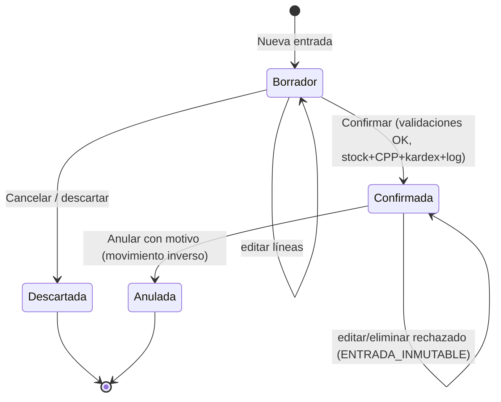

# SPEC-0001: Registrar entrada de mercancía por compra

| Campo | Valor |
|---|---|
| ID | SPEC-0001 |
| Estado | En revisión (viva hasta el cierre de la HU) |
| Versión / fecha | 1.0 · 2026-11-22 |
| Épica · HU · CU | EP04 Movimientos de inventario · HU-04.1 (principal); HU-06.1 (CPP al confirmar) y HU-05.3 (solo «Cargar desde OC») en lo que tocan a esta pantalla · CU.0002 |
| Prioridad · Talla | Alta (MUY IMPORTANTE, URGENTE) · L, 40 h (HU-04.1). Referencia: HU-06.1 Alta L 40 h; HU-05.3 Media M 24 h |
| Actores / roles | Bodeguero y administrador (registran); el administrador puede operar en cualquier sede |
| ADR que la fundamentan | [ADR-0004](../02-adrs/0004-base-datos-postgresql.md) · [ADR-0005](../02-adrs/0005-api-rest-json-https.md) · [ADR-0006](../02-adrs/0006-autenticacion-jwt-autorizacion-rbac-sede.md) · [ADR-0007](../02-adrs/0007-restriccion-acceso-ip-perimetro.md) · [ADR-0009](../02-adrs/0009-integraciones-asincronas-cola-mensajes.md) · [ADR-0012](../02-adrs/0012-kardex-inmutable-movimiento-inverso.md) · [ADR-0013](../02-adrs/0013-log-auditoria-append-only.md) |
| Mockup | [0001-registrar-entrada-mercancia.html](../04-mockups/0001-registrar-entrada-mercancia.html) |
| Problema que resuelve | 3 y 6: sin control de quién modifica cantidades; valoración contable manual y tardía |

## 1. Resumen / objetivo

Permitir que un bodeguero (o el administrador) registre, mediante un formulario web, los productos que ingresan a una sede por compra a un proveedor. Al confirmar, el sistema aumenta el stock de la sede, recalcula el costo promedio ponderado (CPP) de cada producto, registra el movimiento en el kardex y en el log de auditoría, y emite un evento para el envío contable asíncrono. La entrada confirmada es inmodificable: solo se puede anular con motivo, mediante un movimiento inverso.

## 2. Alcance

### Dentro

- Crear, editar y descartar el borrador de una entrada; consecutivo `ENT-{sede}-{n.º}` (p. ej. `ENT-LAU-000482`).
- Proveedor, número de factura o remisión (y adjunto opcional), detalle de líneas con cantidad y costo unitario, subtotal y total.
- Vista previa del nuevo CPP por línea (columna «Nuevo CPP» del prototipo).
- «Cargar desde OC» (HU-05.3) **solo** para precargar las líneas de una orden de compra aprobada; las líneas quedan editables.
- Confirmación atómica: stock + CPP + kardex + log.
- Cálculo del CPP (HU-06.1) al confirmar la entrada.
- Anulación de una entrada confirmada con motivo obligatorio y movimiento inverso.
- Listado y consulta de entradas.
- Emisión del evento de movimiento contable (el envío en sí es HU-08.1).

### Fuera

- Gestión de órdenes de compra (crear, aprobar, cambiar su estado; HU-05.2) y de proveedores (HU-05.1).
- Crear productos (HU-03.1); aquí solo se ofrece la navegación (A1).
- Envío efectivo, reintentos y monitoreo hacia contabilidad (HU-08.1, HU-08.3). Se desconoce la documentación del sistema contable.
- Salidas, ajustes y consulta de kardex (HU-04.2, HU-04.3, HU-04.8), cuentas por pagar y devoluciones al proveedor.
- Aspectos visuales (layout, colores, tamaños): ver mockup.

## 3. Requisitos

### 3.1 Funcionales

| ID | Requisito | Origen |
|---|---|---|
| RF-0001-01 | El sistema debe bloquear el acceso al formulario y a la API desde una IP pública no autorizada para ninguna sede, y registrar el intento en el log. | CU.0002 restricción 1, E1; ADR-0007 |
| RF-0001-02 | El sistema debe verificar que el rol del usuario tenga el permiso `inventario.crear` antes de mostrar o procesar la entrada; si no lo tiene, debe negar el acceso con mensaje y registrar el intento en el log. | CU.0002 paso 2, E2 |
| RF-0001-03 | El sistema debe fijar la sede de la entrada a la sede asignada al usuario; solo el administrador puede elegir otra sede activa. Un intento de otra sede debe negarse y registrarse en el log. | CU.0002 restricción 2, paso 4, E5; HU-04.1 CA4 |
| RF-0001-04 | El sistema debe crear el borrador con la fecha y hora del sistema (no editables) y un consecutivo automático `ENT-{código sede}-{n.º de 6 dígitos}`, único por sede. | CU.0002 paso 4; prototipo |
| RF-0001-05 | El sistema debe exigir un proveedor existente y un número de factura o remisión (texto de 1 a 30 caracteres) y permitir adjuntar opcionalmente un archivo (PDF, JPG o PNG, máx. 5 MB). | CU.0002 paso 5, restricción 7 |
| RF-0001-06 | El sistema debe permitir buscar productos activos por código o nombre y agregarlos al detalle con cantidad y costo unitario. | CU.0002 paso 6 |
| RF-0001-07 | El sistema debe validar que la cantidad sea un entero mayor a cero y que el costo unitario sea un decimal mayor a cero con a lo sumo 2 decimales, indicando el campo y el motivo del error. | CU.0002 restricciones 3-4, E3; HU-04.1 CA2 |
| RF-0001-08 | El sistema debe calcular `subtotal de línea = cantidad × costo unitario` y `total de la entrada = Σ subtotales`, redondeando a 2 decimales (half-up), y recalcularlos al cambiar cualquier línea. | CU.0002 paso 7 |
| RF-0001-09 | El sistema debe permitir una sola línea por producto en la misma entrada y quitar líneas mientras la entrada esté en borrador. | CU.0002 paso 8 (decisión de diseño) |
| RF-0001-10 | El sistema debe mostrar por línea una vista previa del nuevo CPP calculado con la fórmula de RF-0001-16 sin modificar datos. | Prototipo (columna «Nuevo CPP»); HU-06.1 |
| RF-0001-11 | El sistema debe permitir, a un usuario con permiso, precargar el detalle desde una orden de compra aprobada de la misma sede (producto, cantidad pendiente y costo de la OC) y dejar las líneas editables; debe guardar la referencia a la OC. | HU-05.3; prototipo «Cargar desde OC» |
| RF-0001-12 | Cuando un producto no exista, el sistema debe mostrar «Producto no encontrado» y, si el rol tiene permiso de crear productos, ofrecer ir a «Crear producto» y volver con el borrador conservado. | CU.0002 A1 |
| RF-0001-13 | El sistema debe permitir descartar un borrador sin modificar stock, kardex ni CPP. | CU.0002 A2 |
| RF-0001-14 | Al confirmar, el sistema debe validar todo el documento (sede, proveedor, factura, detalle no vacío, cantidades, costos, productos y sede activos) y rechazarlo completo, sin guardar nada, si hay algún error. | CU.0002 paso 10, E3, E4; HU-04.1 CA2, CA3 |
| RF-0001-15 | Al confirmar, el sistema debe ejecutar en **una sola transacción** atómica: cambio de estado a Confirmada, incremento del stock de cada producto en la sede, actualización del CPP, registro del kardex (usuario, sede, fecha y hora) y registro en el log; si algo falla, no debe persistir nada. | CU.0002 paso 11, postcondición; HU-04.1 CA1; ADR-0004 |
| RF-0001-16 | El sistema debe calcular el nuevo CPP por producto y sede: `CPP_nuevo = (stock_actual × CPP_actual + cantidad × costo_unitario) / (stock_actual + cantidad)`, redondeado a 2 decimales (half-up); si `stock_actual = 0`, `CPP_nuevo = costo_unitario`. | HU-06.1; prototipo |
| RF-0001-17 | El sistema debe mostrar al usuario el número de la entrada tras confirmar. | CU.0002 paso 12; HU-04.1 CA1 |
| RF-0001-18 | El sistema debe impedir modificar o eliminar una entrada confirmada, indicar que solo se puede anular y registrar el intento en el log. | CU.0002 restricción 5, E6; HU-04.1 CA5 |
| RF-0001-19 | El sistema debe permitir anular una entrada confirmada solo con motivo obligatorio (mín. 10 caracteres), generando un movimiento inverso en el kardex, descontando el stock, marcando la entrada como Anulada y registrándolo en el log. Requiere permiso `inventario.anular`. | CU.0002 A3; ADR-0012 |
| RF-0001-20 | El sistema debe rechazar la anulación si el movimiento inverso dejaría el stock de algún producto por debajo de cero (error `STOCK_INSUFICIENTE`) y no modificar nada. | ADR-0012; decisión de diseño |
| RF-0001-21 | El sistema debe ser idempotente en confirmar y anular: la misma `Idempotency-Key` o una repetición sobre una entrada ya confirmada (o anulada) no debe duplicar stock, kardex, log ni eventos, y debe devolver el resultado original. | Decisión de diseño (doble clic) |
| RF-0001-22 | El sistema debe rechazar la confirmación si ya existe una entrada Confirmada del mismo proveedor con el mismo número de factura o remisión (las anuladas no cuentan). | Decisión de diseño; pendiente PO (sección 8) |
| RF-0001-23 | El sistema debe serializar las actualizaciones concurrentes de stock y CPP de un mismo producto y sede (bloqueo de fila) para que el CPP resultante sea consistente. | ADR-0004; decisión de diseño |
| RF-0001-24 | Tras confirmar o anular, el sistema debe emitir los eventos de la sección 4.3 (kardex, auditoría, contabilidad, invalidación de caché de stock) sin que su falla revierta la entrada. | Prototipo BPMN (compuerta paralela); HU-08.1; ADR-0009 |
| RF-0001-25 | El sistema debe listar y consultar entradas por sede, estado, proveedor, rango de fechas y número, respetando el alcance de sede del usuario. | CU.0002 (consulta de la entrada confirmada) |

### 3.2 No funcionales

| ID | Categoría | Requisito medible |
|---|---|---|
| RNF-0001-01 | Rendimiento | El registro (confirmación) de una entrada de hasta 50 líneas responde en < 3 s (p95) con 30 usuarios concurrentes en las 6 ubicaciones. |
| RNF-0001-02 | Rendimiento | La búsqueda de producto y la consulta de entradas responden en < 2 s (p95). |
| RNF-0001-03 | Seguridad | Toda llamada va por HTTPS con JWT; la autorización se evalúa en servidor por rol, permiso y sede en cada endpoint (no basta con ocultar controles). |
| RNF-0001-04 | Seguridad | El control por IP se aplica antes de cualquier lógica de negocio; el 100 % de los accesos rechazados queda en el log. |
| RNF-0001-05 | Auditoría | Cada confirmación, anulación, descarte e intento denegado genera un registro append-only con usuario, sede, IP, fecha y hora, acción y entidad. |
| RNF-0001-06 | Integridad | Stock, CPP, kardex y log se persisten en una transacción; ante fallo parcial, 0 cambios persistidos. |
| RNF-0001-07 | Integridad | El kardex es inmutable: no existe endpoint ni permiso para actualizar o eliminar sus filas. |
| RNF-0001-08 | Disponibilidad | Disponible de 6:00 a. m. a 10:00 p. m. (America/Bogota); la caída del sistema contable no afecta el registro. |
| RNF-0001-09 | Disponibilidad | Los datos de entradas están cubiertos por el respaldo automático diario. |
| RNF-0001-10 | i18n / formato | Idioma es-CO; montos en COP mostrados sin decimales con separador de miles (`$ 27.831`) pero calculados y almacenados con 2 decimales; fechas ISO 8601 en la API, zona America/Bogota. |
| RNF-0001-11 | Accesibilidad | Cada error de validación se asocia programáticamente a su campo y es navegable por teclado (objetivo WCAG 2.1 AA, a confirmar con el PO). |
| RNF-0001-12 | Idempotencia | La clave de idempotencia se conserva al menos 24 h. |

## 4. Datos y contratos

### 4.1 Modelo de datos

**Entrada** (`entrada_mercancia`)

| Campo | Tipo | Oblig. | Reglas |
|---|---|---|---|
| id | UUID | Sí | PK |
| consecutivo | texto | Sí | `ENT-{sede.codigo}-{n:06}`; único por sede; inmutable |
| sede_id | UUID | Sí | sede activa; igual a la del usuario salvo administrador |
| proveedor_id | UUID | Sí | proveedor existente |
| numero_documento | texto(30) | Sí | factura o remisión; único entre entradas Confirmadas del mismo proveedor |
| adjunto_url | texto | No | PDF/JPG/PNG ≤ 5 MB |
| orden_compra_id | UUID | No | solo si se precargó desde OC |
| estado | enum | Sí | `BORRADOR`, `CONFIRMADA`, `ANULADA` |
| fecha_creacion | timestamptz | Sí | asignada por el servidor |
| fecha_confirmacion | timestamptz | Si confirmada | servidor |
| total | decimal(14,2) | Sí | Σ subtotales (> 0 al confirmar) |
| creado_por, confirmado_por | UUID | Sí / si confirmada | usuario autenticado |
| motivo_anulacion | texto | Si anulada | 10 a 500 caracteres |
| anulada_por, fecha_anulacion | UUID, timestamptz | Si anulada | |
| version | entero | Sí | control optimista |

**Línea** (`entrada_detalle`)

| Campo | Tipo | Oblig. | Reglas |
|---|---|---|---|
| id | UUID | Sí | PK |
| entrada_id | UUID | Sí | FK |
| producto_id | UUID | Sí | producto activo; único por entrada |
| cantidad | entero | Sí | > 0 y ≤ 999 999 (límite propuesto) |
| costo_unitario | decimal(14,2) | Sí | > 0 y ≤ 99 999 999,99 (límite propuesto) |
| subtotal | decimal(14,2) | Sí | cantidad × costo_unitario |
| stock_previo, cpp_previo | entero, decimal(14,2) | Al confirmar | fotografía para trazabilidad |
| cpp_nuevo | decimal(14,2) | Al confirmar | fórmula RF-0001-16 |

**Stock por producto y sede** (`stock_sede`): `producto_id`, `sede_id`, `cantidad` (entero ≥ 0), `cpp` (decimal(14,2) ≥ 0). El CPP se lleva por producto y sede (pendiente de confirmar, sección 8).

**Kardex** (`kardex_movimiento`, solo inserción): `id`, `fecha_hora`, `sede_id`, `producto_id`, `tipo` (`ENTRADA_COMPRA`, `ANULACION_ENTRADA`), `cantidad` (con signo), `costo_unitario`, `cpp_resultante`, `saldo_resultante`, `usuario_id`, `documento_tipo`, `documento_id`, `motivo`.

Ejemplo de verificación (prototipo): Aceite vegetal 3 L (P-00311), stock 2, CPP previo ≈ 19.803; entrada de 24 und a $28.500: `(2 × 19.803 + 24 × 28.500) / 26 = 723.606 / 26 = 27.831` (nuevo CPP $27.831; subtotal de línea $684.000).

### 4.2 API

Base `/api/v1`. JSON UTF-8. Fechas ISO 8601 (`2026-11-22T10:15:30-05:00`). Cabecera `Authorization: Bearer <JWT>`; `Idempotency-Key` obligatoria en confirmar y anular.

| Método y ruta | Permiso | Descripción |
|---|---|---|
| `POST /entradas` | `inventario.crear` | Crea borrador (asigna consecutivo) |
| `PUT /entradas/{id}` | `inventario.crear` | Reemplaza cabecera y líneas del borrador |
| `POST /entradas/{id}/cargar-desde-oc` | `inventario.crear` | Precarga líneas desde OC aprobada |
| `DELETE /entradas/{id}` | `inventario.crear` | Descarta borrador |
| `POST /entradas/{id}/confirmar` | `inventario.crear` | Confirma (atómico) |
| `POST /entradas/{id}/anular` | `inventario.anular` | Anula con movimiento inverso |
| `GET /entradas` | `inventario.consultar` | Lista con filtros y paginación |
| `GET /entradas/{id}` | `inventario.consultar` | Detalle |

`POST /api/v1/entradas`

```json
{
  "sedeId": "0b6c0b7e-0000-4000-8000-00000000lau1",
  "proveedorId": "5d1a0000-0000-4000-8000-0000000000a1",
  "numeroDocumento": "FV-88213",
  "lineas": [
    { "productoId": "P-00311", "cantidad": 24, "costoUnitario": 28500.00 }
  ]
}
```

Respuesta `201` (borrador, con vista previa de CPP; `sedeId` se ignora si el usuario no es administrador y se usa la suya):

```json
{
  "id": "e7f3c1a2-0000-4000-8000-000000000482",
  "consecutivo": "ENT-LAU-000482",
  "estado": "BORRADOR",
  "sede": { "codigo": "LAU", "nombre": "Laureles" },
  "proveedor": { "id": "5d1a0000-0000-4000-8000-0000000000a1", "nombre": "Distribuidora Andina S.A.S." },
  "numeroDocumento": "FV-88213",
  "fechaCreacion": "2026-11-22T10:15:30-05:00",
  "lineas": [
    { "productoId": "P-00311", "nombre": "Aceite vegetal 3 L", "cantidad": 24, "costoUnitario": 28500.00,
      "subtotal": 684000.00, "stockActual": 2, "cppActual": 19803.00, "cppNuevo": 27831.00 }
  ],
  "total": 684000.00,
  "version": 1
}
```

`POST /api/v1/entradas/{id}/cargar-desde-oc`

```json
{ "ordenCompraId": "OC-2026-0157" }
```

Respuesta `200`: entrada con las líneas precargadas (misma forma que arriba, más `"ordenCompra": "OC-2026-0157"`).

`POST /api/v1/entradas/{id}/confirmar` (cabecera `Idempotency-Key: 3f2a...`; cuerpo `{ "version": 1 }`). Respuesta `200`:

```json
{
  "id": "e7f3c1a2-0000-4000-8000-000000000482",
  "consecutivo": "ENT-LAU-000482",
  "estado": "CONFIRMADA",
  "fechaConfirmacion": "2026-11-22T10:17:02-05:00",
  "total": 684000.00,
  "mensaje": "Entrada ENT-LAU-000482 registrada."
}
```

`POST /api/v1/entradas/{id}/anular`

```json
{ "motivo": "Factura FV-88213 digitada con proveedor equivocado" }
```

Respuesta `200`: `{ "id": "...", "estado": "ANULADA", "movimientosInversos": 1 }`.

`GET /api/v1/entradas?sede=LAU&estado=CONFIRMADA&proveedorId=...&desde=2026-11-01&hasta=2026-11-30&page=1&size=25` → `200` con `{ "items": [...], "page": 1, "size": 25, "total": 130 }`.

Códigos de error: ver 4.4. Formato de error:

```json
{
  "error": {
    "codigo": "VALIDACION",
    "mensaje": "Revise los campos marcados.",
    "detalles": [ { "campo": "lineas[0].cantidad", "motivo": "Debe ser un entero mayor a cero." } ],
    "traceId": "9c1e..."
  }
}
```

### 4.3 Eventos emitidos

| Evento | Destino | Cuándo | Contenido clave |
|---|---|---|---|
| `kardex.movimiento_registrado` | Kardex (misma transacción) | Confirmar / anular | producto, sede, cantidad con signo, costo, CPP y saldo resultantes, usuario, documento |
| `auditoria.registrada` | Log append-only (misma transacción) | Confirmar, anular, descartar, accesos denegados | usuario, sede, IP, acción, entidad, fecha y hora |
| `inventario.entrada_confirmada` / `inventario.entrada_anulada` | Cola (ADR-0009) → contabilidad (HU-08.1) | Tras commit (patrón outbox) | consecutivo, sede, proveedor, documento, líneas (producto, cantidad, costo, CPP nuevo), total, fecha; con clave de idempotencia |
| `stock.cambiado` | Caché (ADR-0008) | Tras commit | sede y productos afectados, para invalidar el dashboard |

### 4.4 Errores

| HTTP | Código | Cuándo | Mensaje al usuario |
|---|---|---|---|
| 401 | NO_AUTENTICADO | JWT ausente o vencido | «Su sesión expiró. Inicie sesión de nuevo.» |
| 403 | IP_NO_AUTORIZADA | IP fuera de las sedes habilitadas (E1) | «Acceso no permitido desde esta ubicación.» |
| 403 | SIN_PERMISO | Rol sin `inventario.crear` / `inventario.anular` (E2) | «No tiene permiso para esta acción.» |
| 403 | SEDE_NO_ASIGNADA | Sede distinta de la asignada, usuario no administrador (E5) | «Solo puede registrar entradas en su sede.» |
| 404 | ENTRADA_NO_ENCONTRADA | Id inexistente o fuera de su alcance | «La entrada no existe.» |
| 404 | PRODUCTO_NO_ENCONTRADO | Producto inexistente (A1) | «Producto no encontrado.» |
| 409 | SEDE_INACTIVA | Sede inactiva | «La sede está inactiva.» |
| 422 | PRODUCTO_INACTIVO | Producto inactivo en el detalle | «El producto P-xxxxx está inactivo.» |
| 422 | VALIDACION | Cantidad/costo inválidos, campos faltantes, línea duplicada (E3) | Motivo por campo |
| 422 | DETALLE_VACIO | Sin líneas al confirmar (E4) | «Debe haber al menos un producto.» |
| 422 | MOTIVO_REQUERIDO | Anulación sin motivo válido | «Indique el motivo de la anulación.» |
| 409 | FACTURA_DUPLICADA | Mismo proveedor y número de documento ya confirmados | «La factura FV-88213 ya fue registrada para este proveedor (ENT-…).» |
| 409 | ENTRADA_INMUTABLE | Editar o eliminar entrada confirmada o anulada (E6) | «Una entrada confirmada no se modifica; solo puede anularse con motivo.» |
| 409 | ENTRADA_ESTADO_INVALIDO | Anular un borrador o una ya anulada; confirmar una anulada | «La acción no aplica al estado actual.» |
| 409 | STOCK_INSUFICIENTE | La anulación dejaría stock negativo | «No se puede anular: el stock actual de {producto} es menor que lo ingresado.» |
| 409 | CONFLICTO_VERSION | `version` desactualizada | «La entrada cambió; recargue.» |
| 409 | OC_NO_DISPONIBLE | OC no aprobada, de otra sede, ya cerrada o sin pendiente | «La orden de compra no está disponible para recibir.» |

## 5. Flujos y estados

**Flujo principal**

1. El usuario elige Inventario → Entradas de mercancía.
2. El sistema verifica IP y permiso `inventario.crear`.
3. El usuario da clic en «Nueva entrada».
4. El sistema crea el borrador y muestra sede (bloqueada), fecha y consecutivo.
5. El usuario selecciona proveedor e ingresa número de factura o remisión (opcionalmente «Cargar desde OC»).
6. El usuario busca un producto e ingresa cantidad y costo unitario.
7. El sistema agrega la línea, calcula subtotal, total y vista previa del nuevo CPP.
8. El usuario repite 6 y 7 por cada producto.
9. El usuario da clic en «Confirmar entrada» (el sistema advierte antes que solo podrá anularse).
10. El sistema valida (cantidades, costos, detalle no vacío, factura no repetida, sede y productos activos).
11. El sistema, en una transacción, confirma, incrementa stock, recalcula CPP y registra kardex y log.
12. El sistema muestra el número de la entrada y emite los eventos (contabilidad asíncrona).

**Alternativos**

| ID | Situación | Comportamiento |
|---|---|---|
| A1 | Producto no existe (paso 6) | «Producto no encontrado»; ofrece «Crear producto» si hay permiso y retorna con el borrador conservado |
| A2 | Cancela antes de confirmar (paso 9) | Descarta el borrador; stock, kardex y CPP sin cambios; el descarte se registra en el log |
| A3 | Anula entrada confirmada | Pide motivo; movimiento inverso; estado Anulada; log |

**Error**

| ID | Situación | Comportamiento |
|---|---|---|
| E1 | IP no autorizada | Bloquea antes de mostrar el formulario; registra en log (`IP_NO_AUTORIZADA`) |
| E2 | Sin permiso (paso 2) | Niega, muestra mensaje, registra en log (`SIN_PERMISO`) |
| E3 | Cantidad o costo inválido (paso 10) | Marca el campo, explica el motivo, no guarda (`VALIDACION`) |
| E4 | Detalle vacío (paso 10) | Indica que debe haber al menos un producto; no guarda (`DETALLE_VACIO`) |
| E5 | Sede distinta a la suya (paso 4) | Niega y registra en log (`SEDE_NO_ASIGNADA`) |
| E6 | Modificar o eliminar entrada confirmada | Niega e indica que solo se puede anular (`ENTRADA_INMUTABLE`) |



## 6. Casos borde

| ID | Caso | Comportamiento esperado |
|---|---|---|
| CB-0001-01 | Producto inexistente (A1) | Ver A1; el borrador no pierde líneas |
| CB-0001-02 | Cancelar antes de confirmar (A2) | Borrador descartado sin efecto en stock |
| CB-0001-03 | Anular entrada confirmada (A3) | Motivo obligatorio, inverso, estado Anulada, log |
| CB-0001-04 | IP no autorizada (E1) | 403, sin formulario, intento en log |
| CB-0001-05 | Sin permiso (E2) | 403 `SIN_PERMISO`, intento en log |
| CB-0001-06 | Cantidad 0, negativa, decimal (`1.5`), texto o fuera de rango (E3) | `VALIDACION` en el campo; no se guarda nada |
| CB-0001-07 | Costo 0, negativo, o con más de 2 decimales (E3) | `VALIDACION`; no se redondea en silencio |
| CB-0001-08 | Detalle vacío (E4) | `DETALLE_VACIO` |
| CB-0001-09 | Sede distinta (E5) | 403 `SEDE_NO_ASIGNADA`, log; el administrador sí puede |
| CB-0001-10 | Editar o eliminar entrada confirmada (E6) | 409 `ENTRADA_INMUTABLE`, log |
| CB-0001-11 | Doble clic o reintento de red en «Confirmar» | Idempotente: un solo stock, kardex, log y evento; la segunda llamada devuelve el mismo resultado |
| CB-0001-12 | Dos entradas confirmadas a la vez para el mismo producto y sede | Bloqueo de fila; se aplican en serie y el CPP final es el de aplicar ambas en orden |
| CB-0001-13 | Producto inactivo en el detalle o inactivado entre borrador y confirmación | `PRODUCTO_INACTIVO` al confirmar; no se guarda |
| CB-0001-14 | Sede inactiva o inactivada antes de confirmar | `SEDE_INACTIVA`; no se guarda |
| CB-0001-15 | Mismo número de factura para el mismo proveedor | `FACTURA_DUPLICADA` (la misma factura con otro proveedor sí es válida); una entrada anulada libera el número |
| CB-0001-16 | Producto repetido en dos líneas | `VALIDACION`; debe consolidarse en una línea |
| CB-0001-17 | Stock previo 0 | `CPP_nuevo = costo_unitario` (sin dividir entre cero) |
| CB-0001-18 | Redondeo del CPP | Se redondea half-up a 2 decimales al persistir; en pantalla sin decimales; el valor de inventario usa el CPP de 2 decimales (el redondeo visual no se re-aplica a los cálculos) |
| CB-0001-19 | Falla en cualquier paso de la transacción (p. ej. error al escribir el log) | Rollback completo: sin stock, kardex ni consecutivo confirmado |
| CB-0001-20 | Contabilidad caída o lenta | La entrada se confirma igual; el evento queda en cola con reintentos (HU-08.3) |
| CB-0001-21 | Anular cuando parte del stock ya salió (stock actual < cantidad de la línea) | `STOCK_INSUFICIENTE`; no se anula; se debe resolver con ajuste (HU-04.3) |
| CB-0001-22 | Anular dos veces o anular un borrador | `ENTRADA_ESTADO_INVALIDO`; la repetición con la misma clave devuelve el resultado original |
| CB-0001-23 | Anulación y CPP | El movimiento inverso sale al CPP vigente y no lo recalcula (por defecto, pendiente del contador) |
| CB-0001-24 | OC de otra sede, no aprobada o sin saldo pendiente | `OC_NO_DISPONIBLE`; el borrador no cambia |
| CB-0001-25 | Líneas precargadas desde OC editadas por el usuario (cantidad distinta) | Se permite; se valida igual que una línea manual; se guarda lo realmente recibido |
| CB-0001-26 | Sesión (JWT) vencida con borrador abierto | `NO_AUTENTICADO`; el borrador del servidor se conserva y se retoma tras iniciar sesión |
| CB-0001-27 | Versión desactualizada (dos pestañas o usuarios editando el mismo borrador) | `CONFLICTO_VERSION`; la última edición no sobrescribe en silencio |
| CB-0001-28 | Administrador cambia de sede con borrador abierto | El consecutivo y el borrador pertenecen a la sede original; para otra sede se crea un borrador nuevo |
| CB-0001-29 | Adjunto con tipo no permitido o mayor de 5 MB | `VALIDACION` en el campo del adjunto |

## 7. Criterios de aceptación

CA-0001-01 a 05 provienen fielmente de HU-04.1 (CA1 a CA5).

| ID | Criterio |
|---|---|
| CA-0001-01 (HU CA1 · Registro exitoso) | **Dado que** estoy autenticado desde una IP autorizada de mi sede y mi rol tiene permiso de creación en inventario, **cuando** selecciono el proveedor, ingreso el número de factura, agrego al menos un producto con cantidad entera mayor a cero y costo mayor a cero, y confirmo la entrada, **entonces** el sistema guarda la entrada con un consecutivo, aumenta el stock de cada producto en mi sede, registra el movimiento en el kardex y en el log con usuario, sede, fecha y hora, y muestra el número de la entrada. |
| CA-0001-02 (HU CA2 · Datos inválidos) | **Dado que** estoy diligenciando una entrada, **cuando** ingreso una cantidad menor o igual a cero, no entera, o un costo menor o igual a cero, y confirmo, **entonces** el sistema marca el campo con error, explica el motivo y no guarda la entrada. |
| CA-0001-03 (HU CA3 · Detalle vacío) | **Dado que** la entrada no tiene productos en el detalle, **cuando** doy clic en «Confirmar entrada», **entonces** el sistema indica que debe haber al menos un producto y no guarda la entrada. |
| CA-0001-04 (HU CA4 · Sede distinta a la asignada) | **Dado que** mi rol es bodeguero y estoy asignado a la sede A, **cuando** intento registrar una entrada en la sede B, **entonces** el sistema niega la operación y registra el intento en el log; solo el administrador puede elegir otra sede. |
| CA-0001-05 (HU CA5 · Entrada confirmada inmodificable) | **Dado que** una entrada ya fue confirmada, **cuando** intento modificarla o eliminarla, **entonces** el sistema lo niega e indica que solo se puede anular con motivo obligatorio, lo que genera un movimiento inverso. |
| CA-0001-06 (CPP) | **Dado que** Aceite vegetal 3 L tiene stock 2 y CPP $19.803 en Laureles, **cuando** confirmo una entrada de 24 und a $28.500, **entonces** el subtotal es $684.000, el stock es 26 y el CPP queda en $27.831 (kardex y vista previa coinciden). |
| CA-0001-07 (Totales) | **Dado que** el detalle tiene dos líneas (10 × 1.250,50 y 3 × 800,00), **cuando** se calculan los importes, **entonces** el total es 14.905,00 (Σ cantidad × costo). |
| CA-0001-08 (Stock cero) | **Dado que** un producto tiene stock 0, **cuando** confirmo una entrada de 5 und a $1.000, **entonces** el CPP queda en $1.000,00. |
| CA-0001-09 (Anulación) | **Dado que** una entrada está confirmada y el stock actual cubre lo ingresado, **cuando** la anulo con un motivo, **entonces** se crea un movimiento inverso en el kardex, el stock baja en esa cantidad, la entrada pasa a Anulada y el evento queda en el log con el motivo. |
| CA-0001-10 (Anulación sin motivo) | **Dado que** anulo una entrada confirmada, **cuando** no indico motivo, **entonces** el sistema responde `MOTIVO_REQUERIDO` y no modifica nada. |
| CA-0001-11 (Anulación sin stock) | **Dado que** el stock actual es menor que lo ingresado por la entrada, **cuando** intento anularla, **entonces** el sistema responde `STOCK_INSUFICIENTE` y no genera movimiento. |
| CA-0001-12 (Idempotencia) | **Dado que** envío «Confirmar» dos veces con la misma `Idempotency-Key`, **cuando** el servidor procesa ambas, **entonces** el stock aumenta una sola vez y existe un solo movimiento de kardex, un solo registro de log y un solo evento contable. |
| CA-0001-13 (Factura repetida) | **Dado que** existe una entrada confirmada del proveedor «Distribuidora Andina S.A.S.» con la factura FV-88213, **cuando** confirmo otra con el mismo proveedor y número, **entonces** el sistema responde `FACTURA_DUPLICADA` y no guarda. |
| CA-0001-14 (Intento denegado) | **Dado que** accedo desde una IP no autorizada o sin el permiso, **cuando** solicito crear una entrada, **entonces** el sistema responde 403 (`IP_NO_AUTORIZADA` o `SIN_PERMISO`) y registra el intento en el log. |
| CA-0001-15 (Atomicidad) | **Dado que** falla el registro del log durante la confirmación, **cuando** el sistema procesa la entrada, **entonces** no cambian stock, CPP ni kardex y el usuario recibe un error reintentable. |
| CA-0001-16 (Producto inexistente) | **Dado que** busco un producto que no existe y mi rol puede crear productos, **cuando** la búsqueda no devuelve resultados, **entonces** el sistema muestra «Producto no encontrado», ofrece ir a «Crear producto» y conserva el borrador al volver. |
| CA-0001-17 (Cargar desde OC) | **Dado que** la OC-2026-0157 está aprobada para mi sede, **cuando** uso «Cargar desde OC», **entonces** el detalle se precarga con sus líneas pendientes, editables, y la entrada guarda la referencia a la OC. |
| CA-0001-18 (Contabilidad asíncrona) | **Dado que** el sistema contable no responde, **cuando** confirmo una entrada, **entonces** la entrada se confirma y el evento contable queda encolado para reintento sin demorar la respuesta. |
| CA-0001-19 (Rendimiento de registro) | **Dado que** hay 30 usuarios concurrentes, **cuando** confirman entradas de hasta 50 líneas, **entonces** el p95 de la respuesta es < 3 s. |
| CA-0001-20 (Rendimiento de consulta) | **Dado que** hay 30 usuarios concurrentes, **cuando** consultan el listado de entradas o buscan productos, **entonces** el p95 de la respuesta es < 2 s. |
| CA-0001-21 (Concurrencia) | **Dado que** dos usuarios confirman a la vez entradas del mismo producto en la misma sede, **cuando** ambas terminan, **entonces** el stock final es la suma de ambas y el CPP es el resultante de aplicarlas en serie. |
| CA-0001-22 (Producto o sede inactivos) | **Dado que** un producto del detalle o la sede están inactivos, **cuando** confirmo, **entonces** el sistema responde `PRODUCTO_INACTIVO` o `SEDE_INACTIVA` y no guarda. |

**Definición de terminado (HU-04.1):** formulario funcionando en el ambiente de pruebas, criterios de aceptación probados por QA, pruebas unitarias de las validaciones, kardex y log verificados, y registro en menos de 3 segundos. Adicional de esta spec: fórmula del CPP verificada con el ejemplo del Aceite vegetal 3 L y evento contable emitido a la cola.

## 8. Riesgos y pendientes

| Tipo | Descripción | Responsable | Estado |
|---|---|---|---|
| Dependencia | No se conoce la documentación del sistema de contabilidad: formato, autenticación y reintentos del envío (HU-08.1). El evento queda definido como contrato interno. | Equipo de desarrollo / contador | Abierto |
| Dependencia | La precarga desde OC (HU-05.3) depende de que HU-05.2 exponga OC aprobadas y su saldo pendiente. | Equipo de desarrollo | Abierto |
| Decisión abierta | ¿El CPP se lleva por producto y sede o global? Esta spec asume por sede (valoración por sede, HU-06.2). | PO / contador | Pendiente |
| Decisión abierta | Tratamiento del CPP en la anulación: por defecto sale al CPP vigente sin recalcular. | Contador | Pendiente |
| Decisión abierta | Número de factura repetido: se bloquea (`FACTURA_DUPLICADA`) frente a solo advertir. | PO | Pendiente |
| Decisión abierta | El consecutivo se asigna al crear el borrador (puede dejar huecos si se descarta) frente a asignarlo al confirmar. | PO | Pendiente |
| Decisión abierta | Límites máximos de cantidad y costo, tamaño y tipo de adjunto y longitud del motivo (valores propuestos en 4.1). | PO | Pendiente |
| Decisión abierta | ¿La confirmación de una entrada desde OC cierra o actualiza el saldo de la OC? Fuera de esta spec; se emite la referencia. | PO | Pendiente |
| Riesgo | Contención de bloqueos en productos de alta rotación al confirmar con 30 usuarios; mitigar con transacciones cortas y validación en HU-09.3. | Equipo de desarrollo | Abierto |
| Riesgo | Reconstruir el CPP si se anula una entrada antigua puede introducir diferencias con la contabilidad. | Contador | Abierto |
