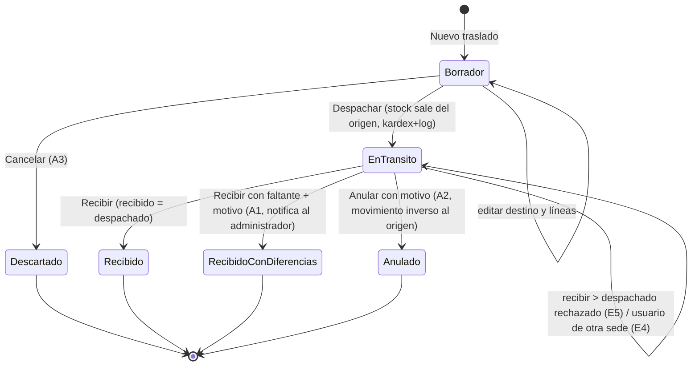

# SPEC-0002: Trasladar mercancía entre sedes

| Campo | Valor |
|---|---|
| ID | SPEC-0002 |
| Estado | En revisión (viva hasta el cierre de las HU) |
| Versión / fecha | 1.0 · 2026-11-22 |
| Épica · HU · CU | EP04 Movimientos de inventario · HU-04.4 Despachar un traslado entre sedes y HU-04.5 Recibir un traslado en la sede destino · CU.0003 |
| Prioridad · Talla | Alta (MUY IMPORTANTE, URGENTE) · HU-04.4 L, 40 h (bodeguero de origen); HU-04.5 L, 40 h (bodeguero de destino) |
| Actores / roles | Bodeguero de la sede origen (crea y despacha), bodeguero de la sede destino (recibe), jefe de sede, administrador (opera en cualquier sede de origen, anula y recibe la notificación de diferencias) |
| ADR que la fundamentan | [ADR-0004](../02-adrs/0004-base-datos-postgresql.md) · [ADR-0005](../02-adrs/0005-api-rest-json-https.md) · [ADR-0006](../02-adrs/0006-autenticacion-jwt-autorizacion-rbac-sede.md) · [ADR-0007](../02-adrs/0007-restriccion-acceso-ip-perimetro.md) · [ADR-0009](../02-adrs/0009-integraciones-asincronas-cola-mensajes.md) · [ADR-0012](../02-adrs/0012-kardex-inmutable-movimiento-inverso.md) · [ADR-0013](../02-adrs/0013-log-auditoria-append-only.md) |
| Mockup | [0002-trasladar-mercancia-entre-sedes.html](../04-mockups/0002-trasladar-mercancia-entre-sedes.html) |
| Problema que resuelve | 2: los traslados se piden por mensajes y se registran a mano, sin trazabilidad de quién despachó, quién recibió y cuándo |

## 1. Resumen / objetivo

Permitir registrar el traslado de productos de una sede de origen a otra sede de destino en dos momentos controlados: el **despacho** en el origen (HU-04.4), que descuenta el stock del origen y lo deja **en tránsito**, y la **recepción confirmada** en el destino (HU-04.5), que suma al destino solo lo que realmente llegó. Si lo recibido difiere de lo despachado, se exige un motivo, el traslado queda «Recibido con diferencias» y se notifica al administrador. Cada movimiento queda en el kardex de origen y destino y en el log con usuario, sede, fecha y hora. Un traslado en tránsito solo puede anularse antes de la recepción, con motivo y movimiento inverso.

## 2. Alcance

### Dentro

- Crear, editar y descartar el borrador de un traslado; consecutivo `TRA-{sede origen}-{n.º}` (p. ej. `TRA-LAU-000138`).
- Selección de la sede destino (distinta de la de origen), búsqueda de productos, consulta del stock disponible en el origen y cantidad a trasladar por línea.
- Despacho atómico: descuento del stock del origen + estado En tránsito + kardex + log (HU-04.4).
- Aviso a la sede destino de que hay un traslado en tránsito hacia ella.
- Recepción en el destino con cantidad recibida por línea, motivo obligatorio si hay diferencia, suma al destino de lo recibido y recálculo del CPP del destino (HU-04.5).
- Notificación al administrador cuando el traslado queda «Recibido con diferencias».
- Anulación de un traslado en tránsito con motivo obligatorio y movimiento inverso al origen.
- Bandejas «Enviados» y «Por recibir», listado y consulta del traslado con su trazabilidad (quién despachó, quién recibió y cuándo).
- Marca de antigüedad en tránsito (más de 48 h) para el seguimiento.

### Fuera

- La decisión y el registro del ajuste por la diferencia (faltante) que tome el administrador: se hace con un ajuste de inventario (HU-04.3) o queda en investigación; aquí solo se registra la diferencia y se notifica.
- Solicitudes de traslado entre sedes previas al borrador (flujo de pedido/aprobación), logística de transporte, rutas, transportadores y guías de despacho (fuera del alcance del proyecto).
- Sugerencia automática de qué trasladar (el dashboard solo navega aquí; SPEC-0004).
- Consulta del kardex (HU-04.8) y reportes en PDF de movimientos (HU-07.5).
- Envío contable de los traslados: se emite el evento, pero si contabilidad lo requiere o no queda pendiente (sección 8).
- Aspectos visuales (layout, colores, tamaños): ver mockup.

## 3. Requisitos

### 3.1 Funcionales

| ID | Requisito | Origen |
|---|---|---|
| RF-0002-01 | El sistema debe bloquear el acceso a traslados (formularios y API) desde una IP pública no autorizada para ninguna sede, y registrar el intento en el log. | CU.0003 restricción 1, E1; ADR-0007 |
| RF-0002-02 | El sistema debe verificar que el rol del usuario tenga el permiso `inventario.crear` antes de crear, despachar o recibir un traslado; si no lo tiene, debe negar el acceso con mensaje y registrar el intento en el log. | CU.0003 precondición, paso 2, E2 |
| RF-0002-03 | El sistema debe fijar la sede origen del traslado a la sede asignada al usuario; solo el administrador puede elegir otra sede origen activa. Un intento de otra sede debe negarse y registrarse en el log. | CU.0003 paso 4; ADR-0006 (decisión de diseño, análoga a CU.0002) |
| RF-0002-04 | El sistema debe crear el borrador con la fecha y hora del sistema (no editables) y un consecutivo automático `TRA-{código sede origen}-{n.º de 6 dígitos}`, único por sede origen. | CU.0003 paso 4 |
| RF-0002-05 | El sistema debe exigir una sede destino activa y distinta de la sede origen. | CU.0003 restricción 2, paso 5 |
| RF-0002-06 | El sistema debe permitir buscar productos activos por código o nombre, mostrar el stock disponible del producto en la sede origen y agregar la línea con la cantidad a trasladar. | CU.0003 pasos 6-7 |
| RF-0002-07 | El sistema debe validar que la cantidad a trasladar sea un entero mayor a cero y no supere el stock disponible en el origen; si lo supera, debe mostrar el stock disponible, marcar el campo con error y no permitir despachar. | CU.0003 restricción 3, paso 7, E3 |
| RF-0002-08 | El sistema debe permitir una sola línea por producto en el mismo traslado y quitar líneas mientras el traslado esté en borrador. | CU.0003 paso 8 (decisión de diseño) |
| RF-0002-09 | El sistema debe permitir descartar un borrador sin modificar stock ni kardex. | CU.0003 A3 |
| RF-0002-10 | Al despachar, el sistema debe validar todo el documento (sede origen y destino activas y distintas, detalle no vacío, productos activos, cantidades válidas y stock suficiente al momento del despacho) y rechazarlo completo, sin guardar nada, si hay algún error. | CU.0003 pasos 7, 9; E3 |
| RF-0002-11 | Al despachar, el sistema debe ejecutar en **una sola transacción** atómica: estado En tránsito, descuento del stock de cada producto en el origen, registro del kardex de salida por traslado en el origen (usuario, sede, fecha y hora) y registro en el log; si algo falla, no debe persistir nada. | CU.0003 paso 10, postcondición; ADR-0004 |
| RF-0002-12 | El sistema debe registrar, por línea, el CPP del producto en el origen al momento del despacho (`cpp_despacho`); la salida no modifica el CPP del origen. | HU-06.1 (decisión de diseño); sección 8 |
| RF-0002-13 | Tras despachar, el sistema debe avisar a la sede destino que existe un traslado en tránsito hacia ella (bandeja «Por recibir» y notificación). | BPMN CU.0003 «Notificar a la sede destino» |
| RF-0002-14 | El sistema debe impedir modificar las líneas o las sedes de un traslado que ya no está en borrador, e indicar la acción permitida según su estado. | CU.0003 restricciones 5-6 (decisión de diseño) |
| RF-0002-15 | La recepción solo puede hacerla un usuario asignado a la sede destino del traslado; un intento de otro usuario debe negarse y registrarse en el log. | CU.0003 restricción 4, E4; HU-04.5 CA4 |
| RF-0002-16 | El sistema debe permitir al usuario de la sede destino abrir un traslado En tránsito hacia su sede, ver lo despachado y registrar por línea la cantidad recibida (entero ≥ 0). | CU.0003 paso 11; HU-04.5 |
| RF-0002-17 | El sistema debe rechazar una cantidad recibida mayor a la despachada, indicar el máximo permitido y no confirmar la recepción. | CU.0003 E5; HU-04.5 CA3 |
| RF-0002-18 | Si alguna cantidad recibida es menor a la despachada, el sistema debe exigir un motivo de la diferencia por cada línea afectada (10 a 500 caracteres) antes de confirmar. | CU.0003 restricción 5, A1; HU-04.5 CA2 |
| RF-0002-19 | Al confirmar la recepción, el sistema debe ejecutar en **una sola transacción**: suma al stock del destino solo de lo recibido, recálculo del CPP del destino (RF-0002-20), registro del kardex de entrada por traslado en el destino, cambio de estado a Recibido (si todo coincide) o Recibido con diferencias (si hay faltantes), y registro en el log. | CU.0003 paso 12, A1, postcondición; HU-04.5 CA1, CA2 |
| RF-0002-20 | El sistema debe recalcular el CPP del destino por producto con `CPP_nuevo_destino = (stock_destino × CPP_destino + cantidad_recibida × cpp_despacho) / (stock_destino + cantidad_recibida)`, redondeado a 2 decimales (half-up); si `stock_destino = 0`, `CPP_nuevo_destino = cpp_despacho`. | HU-06.1 (decisión de diseño); sección 8 |
| RF-0002-21 | El sistema debe calcular por línea `diferencia = cantidad_despachada − cantidad_recibida` y `valor_diferencia = diferencia × cpp_despacho`, y conservar la diferencia en el traslado como «pendiente de gestión del administrador». | CU.0003 A1; BPMN «Revisar diferencia y decidir ajuste o investigación» |
| RF-0002-22 | Cuando el traslado quede «Recibido con diferencias», el sistema debe notificar al administrador con el consecutivo, las sedes, las líneas con diferencia, su valor y los motivos. | CU.0003 A1; HU-04.5 CA2 y definición de terminado |
| RF-0002-23 | El sistema debe permitir anular un traslado En tránsito, antes de la recepción, solo con motivo obligatorio (10 a 500 caracteres), devolviendo el stock al origen con un movimiento inverso en el kardex, cerrando el traslado como Anulado y registrándolo en el log. Requiere permiso `inventario.anular` y pertenecer a la sede origen o ser administrador. | CU.0003 restricción 6, A2, A4; ADR-0012 |
| RF-0002-24 | El sistema debe rechazar la anulación de un traslado Recibido, Recibido con diferencias o ya Anulado, y la recepción de un traslado Anulado. | CU.0003 restricción 6 |
| RF-0002-25 | El sistema debe ser idempotente en despachar, recibir y anular: la misma `Idempotency-Key` o una repetición sobre un traslado ya despachado, recibido o anulado no debe duplicar stock, kardex, log, notificaciones ni eventos, y debe devolver el resultado original. | Decisión de diseño (doble clic) |
| RF-0002-26 | El sistema debe serializar las actualizaciones concurrentes de stock de un mismo producto y sede (bloqueo de fila), de modo que dos despachos simultáneos no dejen stock negativo en el origen. | ADR-0004; decisión de diseño |
| RF-0002-27 | El sistema debe registrar en el traslado la trazabilidad completa: quién creó, quién despachó y cuándo, quién recibió y cuándo, quién anuló, cuándo y por qué. | Problema 2; CU.0003 postcondición; HU-04.5 definición de terminado |
| RF-0002-28 | El sistema debe marcar como «más de 48 h en tránsito» todo traslado En tránsito cuyo despacho tenga más de 48 horas. | Prototipo del dashboard (indicador «2 con más de 48 h»); SPEC-0004 |
| RF-0002-29 | El sistema debe listar traslados en dos bandejas, «Enviados» (sede origen del usuario) y «Por recibir» (sede destino del usuario, En tránsito), con filtros por estado, sede origen, sede destino, rango de fechas y número, respetando el alcance de sede del usuario. | CU.0003 paso 11; HU-04.5 |
| RF-0002-30 | Tras despachar, recibir o anular, el sistema debe emitir los eventos de la sección 4.3 sin que su falla revierta la operación. | ADR-0009 |

### 3.2 No funcionales

| ID | Categoría | Requisito medible |
|---|---|---|
| RNF-0002-01 | Rendimiento | Despachar, recibir o anular un traslado de hasta 50 líneas responde en < 3 s (p95) con 30 usuarios concurrentes en las 6 ubicaciones. |
| RNF-0002-02 | Rendimiento | La consulta del stock disponible en el origen, la búsqueda de productos y el listado de traslados responden en < 2 s (p95). |
| RNF-0002-03 | Seguridad | Toda llamada va por HTTPS con JWT; la autorización por rol, permiso y sede (origen para despachar y anular, destino para recibir) se evalúa en servidor en cada endpoint. |
| RNF-0002-04 | Seguridad | El control por IP se aplica antes de cualquier lógica de negocio; el 100 % de los accesos rechazados queda en el log. |
| RNF-0002-05 | Auditoría | Cada despacho, recepción, anulación, descarte e intento denegado genera un registro append-only con usuario, sede, IP, fecha y hora, acción y entidad. |
| RNF-0002-06 | Integridad | En despachar y en recibir, stock, kardex, estado y log se persisten en una transacción; ante fallo parcial, 0 cambios persistidos. El stock de una sede nunca queda negativo. |
| RNF-0002-07 | Integridad | Conservación: para todo traslado cerrado, `Σ despachado = Σ recibido + Σ diferencia` por producto, y para todo traslado anulado, lo devuelto al origen es igual a lo despachado. |
| RNF-0002-08 | Notificación | El aviso a la sede destino y la notificación al administrador se entregan en ≤ 5 minutos tras el commit (meta propuesta); su falla se reintenta y no revierte la operación. |
| RNF-0002-09 | Disponibilidad | Disponible de 6:00 a. m. a 10:00 p. m. (America/Bogota); los datos de traslados están cubiertos por el respaldo automático diario. |
| RNF-0002-10 | i18n / formato | Idioma es-CO; montos en COP mostrados sin decimales con separador de miles pero calculados y almacenados con 2 decimales; fechas ISO 8601 en la API, zona America/Bogota. |
| RNF-0002-11 | Accesibilidad | Cada error (cantidad, motivo, sede destino) se asocia programáticamente a su campo y es navegable por teclado (objetivo WCAG 2.1 AA, a confirmar con el PO). |
| RNF-0002-12 | Idempotencia | La clave de idempotencia se conserva al menos 24 h. |

## 4. Datos y contratos

### 4.1 Modelo de datos

**Traslado** (`traslado`)

| Campo | Tipo | Oblig. | Reglas |
|---|---|---|---|
| id | UUID | Sí | PK |
| consecutivo | texto | Sí | `TRA-{sede_origen.codigo}-{n:06}`; único por sede origen; inmutable |
| sede_origen_id | UUID | Sí | sede activa; igual a la del usuario salvo administrador |
| sede_destino_id | UUID | Sí | sede activa al despachar; distinta de `sede_origen_id` |
| estado | enum | Sí | `BORRADOR`, `EN_TRANSITO`, `RECIBIDO`, `RECIBIDO_CON_DIFERENCIAS`, `ANULADO` |
| fecha_creacion, creado_por | timestamptz, UUID | Sí | servidor / usuario autenticado |
| fecha_despacho, despachado_por | timestamptz, UUID | Si despachado | servidor / usuario de la sede origen |
| fecha_recepcion, recibido_por | timestamptz, UUID | Si recibido | servidor / usuario asignado a la sede destino |
| motivo_anulacion | texto | Si anulado | 10 a 500 caracteres |
| anulado_por, fecha_anulacion | UUID, timestamptz | Si anulado | |
| diferencia_gestionada | booleano | Si recibido con diferencias | `false` hasta que el administrador la gestione (fuera de alcance) |
| version | entero | Sí | control optimista |

**Línea** (`traslado_detalle`)

| Campo | Tipo | Oblig. | Reglas |
|---|---|---|---|
| id | UUID | Sí | PK |
| traslado_id | UUID | Sí | FK |
| producto_id | UUID | Sí | producto activo al despachar; único por traslado |
| cantidad_despachada | entero | Sí | > 0, ≤ stock disponible del origen al despachar y ≤ 999 999 (límite propuesto) |
| cpp_despacho | decimal(14,2) | Al despachar | CPP del producto en el origen en el momento del despacho |
| cantidad_recibida | entero | Al recibir | ≥ 0 y ≤ `cantidad_despachada` |
| diferencia | entero | Al recibir | `cantidad_despachada − cantidad_recibida` (≥ 0) |
| valor_diferencia | decimal(14,2) | Al recibir | `diferencia × cpp_despacho` |
| motivo_diferencia | texto | Si `diferencia > 0` | 10 a 500 caracteres |

**Stock por producto y sede** (`stock_sede`): `producto_id`, `sede_id`, `cantidad` (entero ≥ 0), `cpp` (decimal(14,2) ≥ 0). Lo que está en tránsito no suma en ninguna sede: es `Σ cantidad_despachada` de los traslados `EN_TRANSITO`, valorizado a `cpp_despacho`.

**Kardex** (`kardex_movimiento`, solo inserción): mismos campos que en SPEC-0001, con `tipo` ∈ {`TRASLADO_SALIDA` (origen, cantidad negativa), `TRASLADO_ENTRADA` (destino, cantidad positiva = recibido), `ANULACION_TRASLADO` (origen, cantidad positiva)}, `documento_tipo = TRASLADO` y `documento_id` = id del traslado, para que la trazabilidad sea visible en el kardex de origen y de destino.

Ejemplo de verificación: `TRA-LAU-000138` de Laureles a Poblado despacha 24 und de Arroz Premium 1 kg (P-00124) con `cpp_despacho` $4.185,00. Poblado tenía 72 und a CPP $4.150,00. Al recibir las 24: stock Poblado = 96 y `CPP_nuevo = (72 × 4.150 + 24 × 4.185) / 96 = 399.240 / 96 = 4.158,75`. Si además se despacharon 10 und de Café molido 500 g (P-02210) con `cpp_despacho` $18.043,00 y se reciben 8: `diferencia = 2`, `valor_diferencia = 36.086,00`, estado `RECIBIDO_CON_DIFERENCIAS`.

### 4.2 API

Base `/api/v1`. JSON UTF-8. Fechas ISO 8601 (`2026-11-22T10:15:30-05:00`). Cabecera `Authorization: Bearer <JWT>`; `Idempotency-Key` obligatoria en despachar, recibir y anular.

| Método y ruta | Permiso | Descripción |
|---|---|---|
| `POST /traslados` | `inventario.crear` (sede origen) | Crea borrador (asigna consecutivo) |
| `PUT /traslados/{id}` | `inventario.crear` (sede origen) | Reemplaza sede destino y líneas del borrador |
| `DELETE /traslados/{id}` | `inventario.crear` (sede origen) | Descarta borrador |
| `POST /traslados/{id}/despachar` | `inventario.crear` (sede origen) | Despacha (atómico): stock sale del origen, En tránsito |
| `POST /traslados/{id}/recibir` | `inventario.crear` (asignado a la sede destino) | Confirma la recepción (atómico) |
| `POST /traslados/{id}/anular` | `inventario.anular` (sede origen o administrador) | Anula en tránsito con movimiento inverso |
| `GET /traslados` | `inventario.consultar` | Lista con filtros, bandeja y paginación |
| `GET /traslados/{id}` | `inventario.consultar` | Detalle con trazabilidad |

`POST /api/v1/traslados`

```json
{
  "sedeOrigenId": "0b6c0b7e-0000-4000-8000-00000000lau1",
  "sedeDestinoId": "0b6c0b7e-0000-4000-8000-00000000pob1",
  "lineas": [
    { "productoId": "P-00124", "cantidad": 24 },
    { "productoId": "P-02210", "cantidad": 10 }
  ]
}
```

Respuesta `201` (borrador con stock disponible; `sedeOrigenId` se ignora si el usuario no es administrador y se usa la suya):

```json
{
  "id": "a1c9d2e4-0000-4000-8000-000000000138",
  "consecutivo": "TRA-LAU-000138",
  "estado": "BORRADOR",
  "sedeOrigen": { "codigo": "LAU", "nombre": "Laureles" },
  "sedeDestino": { "codigo": "POB", "nombre": "Poblado" },
  "fechaCreacion": "2026-11-22T09:40:00-05:00",
  "lineas": [
    { "productoId": "P-00124", "nombre": "Arroz Premium 1 kg", "unidad": "Und", "cantidad": 24, "stockDisponibleOrigen": 111 },
    { "productoId": "P-02210", "nombre": "Café molido 500 g", "unidad": "Und", "cantidad": 10, "stockDisponibleOrigen": 42 }
  ],
  "version": 1
}
```

`POST /api/v1/traslados/{id}/despachar` (cabecera `Idempotency-Key: 7b1e...`; cuerpo `{ "version": 1 }`). Respuesta `200`:

```json
{
  "id": "a1c9d2e4-0000-4000-8000-000000000138",
  "consecutivo": "TRA-LAU-000138",
  "estado": "EN_TRANSITO",
  "fechaDespacho": "2026-11-22T09:45:12-05:00",
  "despachadoPor": { "nombre": "Laura Méndez", "sede": "LAU" },
  "mensaje": "Traslado TRA-LAU-000138 despachado. En tránsito hacia Poblado."
}
```

`POST /api/v1/traslados/{id}/recibir` (cabecera `Idempotency-Key: 9d4f...`)

```json
{
  "version": 2,
  "lineas": [
    { "productoId": "P-00124", "cantidadRecibida": 24 },
    { "productoId": "P-02210", "cantidadRecibida": 8, "motivoDiferencia": "Dos unidades llegaron con el empaque roto y no se recibieron" }
  ]
}
```

Respuesta `200`:

```json
{
  "id": "a1c9d2e4-0000-4000-8000-000000000138",
  "consecutivo": "TRA-LAU-000138",
  "estado": "RECIBIDO_CON_DIFERENCIAS",
  "fechaRecepcion": "2026-11-22T15:20:31-05:00",
  "recibidoPor": { "nombre": "Marta Gil", "sede": "POB" },
  "lineas": [
    { "productoId": "P-00124", "despachada": 24, "recibida": 24, "diferencia": 0, "valorDiferencia": 0.00 },
    { "productoId": "P-02210", "despachada": 10, "recibida": 8, "diferencia": 2, "valorDiferencia": 36086.00 }
  ],
  "administradorNotificado": true
}
```

`POST /api/v1/traslados/{id}/anular`

```json
{ "motivo": "El destino canceló la necesidad; la mercancía no salió de la bodega" }
```

Respuesta `200`: `{ "id": "...", "estado": "ANULADO", "movimientosInversos": 2 }`.

`GET /api/v1/traslados?bandeja=por-recibir&estado=EN_TRANSITO&sedeOrigen=LAU&sedeDestino=POB&desde=2026-11-01&hasta=2026-11-30&page=1&size=25` → `200` con `{ "items": [ { "consecutivo": "TRA-LAU-000138", "estado": "EN_TRANSITO", "horasEnTransito": 5.6, "masDe48h": false, ... } ], "page": 1, "size": 25, "total": 14 }`. `bandeja` ∈ {`enviados`, `por-recibir`}.

Formato de error: el mismo de SPEC-0001 (`{ "error": { "codigo", "mensaje", "detalles": [ { "campo", "motivo" } ], "traceId" } }`). Ejemplo de E3:

```json
{
  "error": {
    "codigo": "STOCK_INSUFICIENTE",
    "mensaje": "La cantidad supera el stock disponible en el origen.",
    "detalles": [ { "campo": "lineas[2].cantidad", "motivo": "Stock disponible en Laureles: 26." } ],
    "traceId": "4be0..."
  }
}
```

### 4.3 Eventos emitidos

| Evento | Destino | Cuándo | Contenido clave |
|---|---|---|---|
| `kardex.movimiento_registrado` | Kardex (misma transacción) | Despachar (origen), recibir (destino), anular (origen) | producto, sede, cantidad con signo, costo (`cpp_despacho`), CPP y saldo resultantes, usuario, documento |
| `auditoria.registrada` | Log append-only (misma transacción) | Despachar, recibir, anular, descartar, accesos denegados | usuario, sede, IP, acción, entidad, fecha y hora |
| `inventario.traslado_despachado` | Cola (ADR-0009) → aviso a la sede destino | Tras commit (patrón outbox) | consecutivo, sedes, líneas, fecha de despacho |
| `inventario.traslado_recibido` / `inventario.traslado_recibido_con_diferencias` | Cola → notificación al administrador (solo con diferencias) y contabilidad (si aplica, sección 8) | Tras commit | consecutivo, sedes, líneas con despachado, recibido, diferencia, valor y motivo; quién despachó y quién recibió |
| `inventario.traslado_anulado` | Cola → aviso a la sede destino | Tras commit | consecutivo, motivo, usuario |
| `stock.cambiado` | Caché (ADR-0008) | Tras commit de despachar, recibir y anular | sedes y productos afectados, para invalidar el dashboard |

### 4.4 Errores

| HTTP | Código | Cuándo | Mensaje al usuario |
|---|---|---|---|
| 401 | NO_AUTENTICADO | JWT ausente o vencido | «Su sesión expiró. Inicie sesión de nuevo.» |
| 403 | IP_NO_AUTORIZADA | IP fuera de las sedes habilitadas (E1) | «Acceso no permitido desde esta ubicación.» |
| 403 | SIN_PERMISO | Rol sin `inventario.crear` / `inventario.anular` (E2) | «No tiene permiso para esta acción.» |
| 403 | SEDE_NO_ASIGNADA | Despachar o anular desde una sede origen distinta de la asignada (no administrador), o recibir sin estar asignado a la sede destino (E4) | «Solo un usuario de la sede {sede} puede realizar esta acción.» |
| 404 | TRASLADO_NO_ENCONTRADO | Id inexistente o fuera de su alcance | «El traslado no existe.» |
| 404 | PRODUCTO_NO_ENCONTRADO | Producto inexistente en la búsqueda | «Producto no encontrado.» |
| 409 | SEDE_INACTIVA | Sede origen o destino inactiva al despachar | «La sede {sede} está inactiva.» |
| 422 | SEDES_IGUALES | Sede destino igual a la sede origen | «La sede destino debe ser distinta de la sede origen.» |
| 422 | PRODUCTO_INACTIVO | Producto inactivo en el detalle al despachar | «El producto P-xxxxx está inactivo.» |
| 422 | VALIDACION | Cantidad no entera o ≤ 0, campos faltantes, línea duplicada | Motivo por campo |
| 422 | DETALLE_VACIO | Sin líneas al despachar | «Debe haber al menos un producto.» |
| 409 | STOCK_INSUFICIENTE | Cantidad a trasladar mayor al stock disponible del origen (E3), también si cambió entre el borrador y el despacho | «Stock disponible en {sede}: {n}.» |
| 422 | CANTIDAD_RECIBIDA_EXCEDE | Cantidad recibida mayor a la despachada (E5) | «La cantidad recibida no puede superar la despachada. Máximo permitido: {n}.» |
| 422 | MOTIVO_REQUERIDO | Recepción con diferencia sin motivo, o anulación sin motivo válido | «Indique el motivo de la diferencia» / «Indique el motivo de la anulación.» |
| 409 | TRASLADO_INMUTABLE | Editar sedes o líneas de un traslado que no está en borrador | «El traslado ya fue despachado; no se puede modificar.» |
| 409 | TRASLADO_ESTADO_INVALIDO | Despachar algo que no es borrador; recibir algo que no está en tránsito; anular algo recibido, con diferencias o ya anulado | «La acción no aplica al estado actual del traslado ({estado}).» |
| 409 | CONFLICTO_VERSION | `version` desactualizada | «El traslado cambió; recargue.» |

## 5. Flujos y estados

**Flujo principal** (normalizado desde la secuencia normal de CU.0003: en la fuente los pasos 7 y 8 están duplicados; el paso 8 se reemplaza por la repetición de 6 y 7, como en CU.0002).

1. El usuario de la sede origen elige Inventario → Traslados.
2. El sistema verifica IP y permiso `inventario.crear`.
3. El usuario da clic en «Nuevo traslado».
4. El sistema crea el borrador y muestra la sede origen (bloqueada), la fecha y el consecutivo.
5. El usuario selecciona la sede destino.
6. El usuario busca cada producto e ingresa la cantidad a trasladar.
7. El sistema muestra el stock disponible en el origen y valida la cantidad.
8. El usuario repite 6 y 7 por cada producto.
9. El usuario da clic en «Despachar» (el sistema pide confirmación: el stock saldrá del origen y quedará en tránsito).
10. El sistema, en una transacción, descuenta el stock del origen, pone el traslado En tránsito y registra kardex y log; avisa a la sede destino.
11. El usuario de la sede destino abre el traslado en tránsito, verifica físicamente la mercancía y registra la cantidad recibida de cada línea.
12. El sistema, en una transacción, suma el stock en el destino, recalcula el CPP del destino, cierra el traslado como Recibido y registra kardex y log.

**Alternativos** (A4 de la fuente repite A2; se unifican)

| ID | Situación | Comportamiento |
|---|---|---|
| A1 | Cantidad recibida distinta (menor) a la despachada (paso 11) | Exige motivo por línea; suma al destino solo lo recibido; estado Recibido con diferencias; registra la diferencia valorizada y notifica al administrador |
| A2 | Anulación del traslado en tránsito (después del paso 10, antes del 12) | Pide motivo obligatorio; devuelve el stock al origen con movimiento inverso; estado Anulado; log; aviso a la sede destino |
| A3 | Cancela antes de despachar (antes del paso 9) | Descarta el borrador; stock y kardex sin cambios; el descarte se registra en el log |

**Error**

| ID | Situación | Comportamiento |
|---|---|---|
| E1 | IP no autorizada | Bloquea antes de mostrar el formulario; registra en log (`IP_NO_AUTORIZADA`) |
| E2 | Sin permiso de creación en inventario (paso 2) | Niega, muestra mensaje, registra en log (`SIN_PERMISO`) |
| E3 | Cantidad mayor al stock disponible en el origen (pasos 7 y 10) | Muestra el stock disponible, marca el campo y no permite despachar (`STOCK_INSUFICIENTE`) |
| E4 | El usuario no pertenece a la sede destino (paso 11; en la fuente «paso 10») | Niega la recepción y registra en log (`SEDE_NO_ASIGNADA`) |
| E5 | Cantidad recibida mayor a la despachada (paso 11) | Rechaza la cantidad, indica el máximo permitido y no confirma (`CANTIDAD_RECIBIDA_EXCEDE`) |



## 6. Casos borde

| ID | Caso | Comportamiento esperado |
|---|---|---|
| CB-0002-01 | IP no autorizada (E1) | 403 `IP_NO_AUTORIZADA`, sin formulario, intento en log |
| CB-0002-02 | Sin permiso (E2) | 403 `SIN_PERMISO`, intento en log |
| CB-0002-03 | Cantidad mayor al stock disponible del origen (E3) | `STOCK_INSUFICIENTE` con el disponible; no se despacha |
| CB-0002-04 | Usuario no asignado a la sede destino intenta recibir (E4), incluido un usuario de la sede origen | 403 `SEDE_NO_ASIGNADA`, intento en log; el traslado sigue En tránsito |
| CB-0002-05 | Cantidad recibida mayor a la despachada (E5) | `CANTIDAD_RECIBIDA_EXCEDE` con el máximo; nada se confirma |
| CB-0002-06 | Recepción con faltante en una o varias líneas (A1) | Motivo por línea; destino suma lo recibido; Recibido con diferencias; administrador notificado |
| CB-0002-07 | Cantidad recibida 0 en una línea (nada llegó de ese producto) | Válido; diferencia = despachado; motivo obligatorio; Recibido con diferencias |
| CB-0002-08 | Diferencia sin motivo | `MOTIVO_REQUERIDO`; no se confirma |
| CB-0002-09 | Sede destino igual a la origen | `SEDES_IGUALES` |
| CB-0002-10 | Dos despachos simultáneos desde la misma sede que juntos superan el stock de un producto | Bloqueo de fila: el primero se despacha; el segundo recibe `STOCK_INSUFICIENTE` y no modifica nada |
| CB-0002-11 | El stock del origen cambió entre el borrador y el despacho (p. ej. una salida o una venta descontada) | Se revalida al despachar; si no alcanza, `STOCK_INSUFICIENTE` con el nuevo disponible |
| CB-0002-12 | El borrador no reserva stock | Otro movimiento puede consumir el disponible antes de despachar (ver CB-0002-11 y sección 8) |
| CB-0002-13 | Doble clic o reintento de red en «Despachar» o «Confirmar recepción» | Idempotente: un solo descuento o suma, un solo kardex, log, aviso y evento; la segunda llamada devuelve el mismo resultado |
| CB-0002-14 | Dos usuarios del destino confirman la recepción a la vez | El primero confirma; el segundo recibe `TRASLADO_ESTADO_INVALIDO` (o `CONFLICTO_VERSION`) sin duplicar stock |
| CB-0002-15 | Anulación y recepción simultáneas | Se serializan por versión del traslado: la que confirme primero gana; la otra recibe `TRASLADO_ESTADO_INVALIDO` |
| CB-0002-16 | Anular un traslado Recibido o Recibido con diferencias | `TRASLADO_ESTADO_INVALIDO`; para revertir se usa un traslado en sentido contrario o un ajuste |
| CB-0002-17 | Anular sin motivo o con motivo de menos de 10 caracteres | `MOTIVO_REQUERIDO`; no se modifica nada |
| CB-0002-18 | Editar líneas o sedes de un traslado En tránsito | `TRASLADO_INMUTABLE` |
| CB-0002-19 | Producto inactivado mientras el traslado está En tránsito | La recepción se permite (la mercancía existe físicamente); solo se bloquea al despachar (`PRODUCTO_INACTIVO`) |
| CB-0002-20 | Sede destino inactivada mientras el traslado está En tránsito | Por defecto se permite recibir para cerrar el tránsito, o anular; pendiente de confirmar con el PO (sección 8) |
| CB-0002-21 | Traslado con más de 48 h En tránsito | Queda marcado «más de 48 h» en listados y en el dashboard; no cambia de estado solo |
| CB-0002-22 | Stock del destino en 0 al recibir | `CPP_nuevo_destino = cpp_despacho` (sin dividir entre cero) |
| CB-0002-23 | Redondeo del CPP del destino | Half-up a 2 decimales al persistir; en pantalla sin decimales; la valoración usa el CPP de 2 decimales |
| CB-0002-24 | Anulación con stock del origen recibido de vuelta | El stock vuelve al origen a `cpp_despacho`, recalculando el CPP del origen con la misma fórmula ponderada (por defecto, pendiente del contador) |
| CB-0002-25 | Falla en cualquier paso de la transacción de despacho o de recepción (p. ej. error al escribir el log) | Rollback completo: estado, stock y kardex sin cambios; error reintentable |
| CB-0002-26 | Falla del envío del aviso al destino o de la notificación al administrador | La operación queda confirmada; el evento se reintenta desde la cola; el traslado también aparece en la bandeja «Por recibir» |
| CB-0002-27 | Producto repetido en dos líneas | `VALIDACION`; debe consolidarse en una línea |
| CB-0002-28 | Administrador despacha desde una sede que no es la suya | Permitido; queda en el log con el usuario administrador y la sede origen elegida |
| CB-0002-29 | Sesión (JWT) vencida con el formulario de recepción abierto | `NO_AUTENTICADO`; no se confirma nada; el traslado sigue En tránsito |

## 7. Criterios de aceptación

CA-0002-01 a 04 provienen fielmente de HU-04.5 (CA1 a CA4). HU-04.4 no tiene criterios formales en la fuente: CA-0002-05 a 10 se derivan de CU.0003 (restricciones, paso 10, E3 y A2/A3).

| ID | Criterio |
|---|---|
| CA-0002-01 (HU-04.5 CA1 · Recepción completa) | **Dado que** existe un traslado «en tránsito» hacia mi sede y estoy asignado a ella, **cuando** confirmo la recepción con cantidades iguales a las despachadas, **entonces** el sistema suma el stock en mi sede, cierra el traslado como «recibido» y registra el movimiento en el kardex y en el log con usuario, sede, fecha y hora. |
| CA-0002-02 (HU-04.5 CA2 · Recepción con diferencias) | **Dado que** recibo menos unidades de las despachadas, **cuando** ingreso la cantidad recibida, **entonces** el sistema exige un motivo, suma a mi sede solo lo recibido, marca el traslado como «recibido con diferencias» y notifica al administrador. |
| CA-0002-03 (HU-04.5 CA3 · Cantidad mayor a la despachada) | **Dado que** estoy confirmando un traslado, **cuando** ingreso una cantidad recibida mayor a la despachada, **entonces** el sistema rechaza la cantidad, indica el máximo permitido y no confirma la recepción. |
| CA-0002-04 (HU-04.5 CA4 · Usuario de otra sede) | **Dado que** no estoy asignado a la sede destino del traslado, **cuando** intento confirmar la recepción, **entonces** el sistema niega la recepción y registra el intento en el log. |
| CA-0002-05 (HU-04.4 · Despacho exitoso) | **Dado que** estoy autenticado desde una IP autorizada de la sede Laureles con permiso de creación en inventario y el Arroz Premium 1 kg tiene 111 und disponibles, **cuando** creo un traslado a Poblado con 24 und y doy clic en «Despachar», **entonces** el stock de Laureles queda en 87, el traslado queda «en tránsito» con su consecutivo, se registra la salida en el kardex de Laureles y en el log con usuario, sede, fecha y hora, y la sede Poblado ve el traslado en «Por recibir». |
| CA-0002-06 (HU-04.4 · Stock insuficiente) | **Dado que** el Aceite vegetal 3 L tiene 26 und disponibles en el origen, **cuando** intento trasladar 40, **entonces** el sistema muestra «Stock disponible en Laureles: 26», marca el campo con error y no permite despachar. |
| CA-0002-07 (HU-04.4 · Misma sede) | **Dado que** mi sede origen es Laureles, **cuando** selecciono Laureles como destino, **entonces** el sistema indica que la sede destino debe ser distinta y no permite despachar. |
| CA-0002-08 (HU-04.4 · Cancelar borrador) | **Dado que** tengo un traslado en borrador, **cuando** lo cancelo, **entonces** el borrador se descarta y el stock del origen no cambia. |
| CA-0002-09 (Anulación en tránsito) | **Dado que** un traslado está «en tránsito» y aún no se ha recibido, **cuando** lo anulo indicando un motivo, **entonces** el stock vuelve al origen con un movimiento inverso en el kardex, el traslado queda «anulado» y el evento queda en el log con el motivo. |
| CA-0002-10 (Anulación no permitida) | **Dado que** un traslado ya fue recibido (con o sin diferencias), **cuando** intento anularlo, **entonces** el sistema responde `TRASLADO_ESTADO_INVALIDO` y no modifica nada. |
| CA-0002-11 (CPP del destino) | **Dado que** Poblado tiene 72 und de Arroz Premium 1 kg a CPP $4.150 y el traslado despachó 24 und con CPP de despacho $4.185, **cuando** se confirma la recepción completa, **entonces** el stock de Poblado es 96 y su CPP queda en $4.158,75. |
| CA-0002-12 (Diferencia valorizada) | **Dado que** se despacharon 10 und de Café molido 500 g con CPP de despacho $18.043 y se reciben 8, **cuando** se confirma la recepción con motivo, **entonces** la línea registra diferencia 2 y valor $36.086, y la notificación al administrador incluye esa línea y su motivo. |
| CA-0002-13 (Motivo obligatorio) | **Dado que** una línea tiene cantidad recibida menor a la despachada, **cuando** intento confirmar sin motivo, **entonces** el sistema responde `MOTIVO_REQUERIDO` y no confirma la recepción. |
| CA-0002-14 (Trazabilidad) | **Dado que** un traslado fue despachado y recibido, **cuando** consulto su detalle o el kardex de origen y de destino, **entonces** veo quién despachó, quién recibió, las fechas y horas de ambos momentos y el mismo consecutivo como documento en ambos kardex. |
| CA-0002-15 (Concurrencia) | **Dado que** un producto tiene 30 und en el origen, **cuando** dos usuarios despachan a la vez traslados de 20 und de ese producto, **entonces** solo uno se despacha, el otro recibe `STOCK_INSUFICIENTE` y el stock del origen queda en 10. |
| CA-0002-16 (Idempotencia) | **Dado que** envío «Despachar» dos veces con la misma `Idempotency-Key`, **cuando** el servidor procesa ambas, **entonces** el stock del origen baja una sola vez y existe un solo movimiento de kardex, un solo registro de log y un solo aviso al destino. |
| CA-0002-17 (Atomicidad) | **Dado que** falla el registro del log durante la recepción, **cuando** el sistema procesa la confirmación, **entonces** no cambian el stock del destino, el CPP, el kardex ni el estado del traslado, y el usuario recibe un error reintentable. |
| CA-0002-18 (Más de 48 h) | **Dado que** un traslado fue despachado hace más de 48 horas y sigue en tránsito, **cuando** consulto el listado de traslados, **entonces** aparece marcado como «más de 48 h en tránsito». |
| CA-0002-19 (Intento denegado) | **Dado que** accedo desde una IP no autorizada o sin el permiso, **cuando** solicito crear, despachar o recibir un traslado, **entonces** el sistema responde 403 (`IP_NO_AUTORIZADA` o `SIN_PERMISO`) y registra el intento en el log. |
| CA-0002-20 (Rendimiento de operación) | **Dado que** hay 30 usuarios concurrentes, **cuando** despachan o reciben traslados de hasta 50 líneas, **entonces** el p95 de la respuesta es < 3 s. |
| CA-0002-21 (Rendimiento de consulta) | **Dado que** hay 30 usuarios concurrentes, **cuando** consultan el stock disponible en el origen o el listado de traslados, **entonces** el p95 de la respuesta es < 2 s. |

**Definición de terminado (HU-04.5):** estados del traslado (en tránsito, recibido, recibido con diferencias) validados, notificación al administrador funcionando, criterios probados por QA y trazabilidad visible en el kardex de origen y destino. **Adicional de esta spec (HU-04.4):** despacho atómico verificado (stock, kardex y log), validación de stock disponible y de sede distinta probadas por QA, anulación en tránsito con movimiento inverso verificada, y despacho y recepción en menos de 3 segundos.

## 8. Riesgos y pendientes

| Tipo | Descripción | Responsable | Estado |
|---|---|---|---|
| Decisión abierta | Tratamiento del faltante de un traslado «recibido con diferencias»: esta spec lo deja registrado y valorizado como «pendiente de gestión del administrador»; el ajuste (pérdida, hurto, daño en transporte) se registra con HU-04.3 o queda en investigación. Falta definir si el faltante se valoriza como pérdida automáticamente y en qué plazo debe gestionarse. | PO / contador | Pendiente |
| Decisión abierta | Costo de la mercancía trasladada: se asume que entra al destino al `cpp_despacho` del origen y recalcula el CPP del destino (RF-0002-20), y que la salida no cambia el CPP del origen. | Contador | Pendiente |
| Decisión abierta | Anulación en tránsito: se asume reingreso al origen a `cpp_despacho`, recalculando el CPP del origen con la fórmula ponderada (CB-0002-24). | Contador | Pendiente |
| Decisión abierta | ¿El borrador debe reservar stock del origen? Por defecto no reserva; se revalida al despachar (CB-0002-12). | PO | Pendiente |
| Decisión abierta | ¿Se admiten recepciones parciales en varios momentos (el faltante llega después)? Por defecto no: una sola recepción cierra el traslado; el faltante que llegue después se registra con un nuevo traslado o un ajuste. | PO | Pendiente |
| Decisión abierta | ¿El administrador puede recibir un traslado sin estar asignado a la sede destino? La restricción literal del CU dice que solo un usuario asignado al destino; esta spec la aplica tal cual. | PO | Pendiente |
| Decisión abierta | Canal de la notificación al administrador y del aviso a la sede destino (correo y/o aviso en la aplicación) y destinatarios cuando hay varios administradores. | PO | Pendiente |
| Decisión abierta | ¿El valor en tránsito se incluye en la valoración consolidada (HU-06.2) y en el envío a contabilidad? ¿Los traslados entre sedes generan movimiento contable? Se emite el evento por si se requiere. | Contador | Pendiente |
| Decisión abierta | Recepción cuando la sede destino se inactivó durante el tránsito (CB-0002-20). Por defecto se permite recibir o anular. | PO | Pendiente |
| Decisión abierta | Umbral de alerta de tránsito (48 h, tomado del prototipo del dashboard) y si además debe notificar a alguien. | PO | Pendiente |
| Dependencia | La notificación y el aviso dependen de la cola de integraciones y del servicio de correo (ADR-0009). | Equipo de desarrollo | Abierto |
| Riesgo | Mercancía que se mueve físicamente sin despacho en el sistema (hábito de pedir por mensajes) rompe la trazabilidad; mitigar con capacitación (HU-09.5) y seguimiento de traslados de más de 48 h. | PO / jefes de sede | Abierto |
| Riesgo | Contención de bloqueos en productos de alta rotación al despachar con 30 usuarios; mitigar con transacciones cortas y validación en HU-09.3. | Equipo de desarrollo | Abierto |
| Documentación | La fuente duplica los pasos 7-8 de la secuencia normal, repite A2 en A4 y referencia E4 al «paso 10»; esta spec los normaliza (sección 5). | Analista de requisitos | Resuelto en esta spec |
