# SPEC-0003: Toma física de inventario y conciliación de diferencias

| Campo | Valor |
|---|---|
| ID | SPEC-0003 |
| Estado | En revisión (viva hasta el cierre de la HU) |
| Versión / fecha | 1.0 · 2026-11-22 |
| Épica · HU · CU | EP04 Movimientos de inventario · HU-04.6 (principal); HU-07.6 solo en lo que toca a habilitar el reporte de diferencias de la toma · CU.0004 |
| Prioridad · Talla | Alta (MUY IMPORTANTE, urgencia MEDIA) · XL, 64 h (HU-04.6). Referencia: HU-07.6 Media S 16 h |
| Actores / roles | Jefe de sede (abre la toma, cierra el conteo, registra motivos y envía a aprobación), bodeguero (registra el conteo ciego), administrador (aprueba o rechaza los ajustes; puede operar en cualquier sede) |
| ADR que la fundamentan | [ADR-0004](../02-adrs/0004-base-datos-postgresql.md) · [ADR-0005](../02-adrs/0005-api-rest-json-https.md) · [ADR-0006](../02-adrs/0006-autenticacion-jwt-autorizacion-rbac-sede.md) · [ADR-0007](../02-adrs/0007-restriccion-acceso-ip-perimetro.md) · [ADR-0012](../02-adrs/0012-kardex-inmutable-movimiento-inverso.md) · [ADR-0013](../02-adrs/0013-log-auditoria-append-only.md) · [ADR-0014](../02-adrs/0014-reportes-pdf-predefinidos-servidor.md) |
| Mockup | [0003-toma-fisica-conciliacion.html](../04-mockups/0003-toma-fisica-conciliacion.html) |
| Problema que resuelve | 5: conteos físicos manuales, de varios días, cuyas diferencias no se concilian de forma controlada (alimenta también el 6: valoración para contabilidad) |

## 1. Resumen / objetivo

Permitir contar físicamente los productos de una sede (toda la sede o una categoría) con **conteo ciego**, comparar lo contado con el stock esperado del sistema a partir de una **fotografía** tomada al abrir la toma, justificar cada diferencia con un motivo y aplicar como **ajustes en el kardex** solo las diferencias aprobadas. Las diferencias que superan la tolerancia configurada requieren aprobación del administrador. Al cerrar, el stock de la sede queda conciliado, la toma se vuelve inmodificable y se habilita el reporte de diferencias en PDF.

## 2. Alcance

### Dentro

- Abrir una toma con alcance «toda la sede» o «una categoría»; consecutivo `TF-{sede}-{n.º}` (p. ej. `TF-LAU-000013`).
- Una sola toma abierta por sede.
- Fotografía del stock (cantidad y CPP por producto) al abrir y copia de la tolerancia vigente.
- Lista de conteo ciega; registro y corrección de cantidades contadas mientras el conteo esté abierto (guardar avance).
- Cierre del conteo con tratamiento de productos sin contar.
- Cálculo de diferencias en cantidad, valor y porcentaje; marca de las que superan la tolerancia.
- Registro obligatorio del motivo de cada diferencia (merma, error de registro, hurto, daño).
- Aprobación o rechazo por línea por parte del administrador; reconteo de líneas rechazadas.
- Aplicación atómica de los ajustes aprobados (stock + kardex + log) y cierre de la toma.
- Cancelación de la toma antes de cerrar el conteo.
- Solicitud del reporte de diferencias de **esta** toma en PDF (generación en servidor, ADR-0014).
- Listado y consulta de tomas.

### Fuera

- Reporte de diferencias de toma física con filtros por período y sede (HU-07.6) más allá de la toma individual.
- Ajustes manuales fuera de una toma (HU-04.3) y anulación genérica de movimientos (HU-04.7).
- Configuración de categorías (HU-03.3) y del catálogo (HU-03.1, HU-03.2).
- Envío efectivo de la valoración y de los ajustes a contabilidad (HU-08.1); aquí solo se emite el evento.
- Aplicación móvil nativa o modo sin conexión para contar (fuera del alcance del proyecto).
- Aspectos visuales (layout, colores, tamaños): ver mockup.

## 3. Requisitos

### 3.1 Funcionales

| ID | Requisito | Origen |
|---|---|---|
| RF-0003-01 | El sistema debe bloquear el acceso a la toma física (pantallas y API) desde una IP pública no autorizada y registrar el intento en el log. | CU.0004 restricción 1, E1; ADR-0007 |
| RF-0003-02 | El sistema debe exigir el permiso `inventario.crear` para abrir, contar, cerrar el conteo, registrar motivos, enviar a aprobación y cancelar; si falta, debe negar el acceso y registrar el intento en el log. | CU.0004 precondición, E2 |
| RF-0003-03 | El sistema debe limitar la toma a la sede asignada al usuario; solo el administrador puede operar tomas de otra sede. Un intento sobre otra sede debe negarse y registrarse en el log. | ADR-0006; regla general de sede (necesidades §5) |
| RF-0003-04 | El sistema debe abrir la toma con alcance `SEDE` o `CATEGORIA` (categoría existente), fecha y hora del servidor y un consecutivo automático `TF-{código sede}-{n.º de 6 dígitos}`, único por sede. | CU.0004 paso 2 |
| RF-0003-05 | El sistema debe impedir abrir una toma si la sede ya tiene otra no cerrada ni cancelada (cualquiera que sea su alcance) e informar el consecutivo de la existente. | CU.0004 precondición, E3; HU-04.6 CA2 |
| RF-0003-06 | Al abrir, el sistema debe guardar en una transacción la **fotografía** de cada producto activo del alcance con registro de stock en la sede (cantidad y CPP en ese instante) y copiar a la toma el porcentaje de tolerancia vigente. La fotografía es inmutable. | CU.0004 paso 3, restricción 3; HU-04.6 CA1 |
| RF-0003-07 | El sistema debe generar la lista de conteo sin exponer cantidades del sistema: mientras la toma esté `EN_CONTEO`, ningún endpoint de la toma devuelve cantidades de la fotografía, esperadas ni diferencias. | CU.0004 restricción 2 (conteo ciego), paso 3; HU-04.6 CA1 |
| RF-0003-08 | El sistema debe permitir registrar y corregir la cantidad contada de cada línea mientras la toma esté `EN_CONTEO`, validando que sea un entero ≥ 0 y guardando quién contó y cuándo. | CU.0004 paso 4, E4 |
| RF-0003-09 | El sistema debe permitir agregar a la toma un producto activo del alcance que se encontró físicamente y no estaba en la lista; su fotografía es 0. | Decisión de diseño (producto no listado) |
| RF-0003-10 | Al cerrar el conteo, si hay líneas sin contar, el sistema debe listarlas y permitir cerrar solo si el usuario confirma explícitamente que su cantidad es cero. | CU.0004 paso 5, A1 |
| RF-0003-11 | Al cerrar el conteo, el sistema debe calcular por línea `esperado = cantidad_fotografía + Σ movimientos confirmados del producto en la sede entre la apertura de la toma y el cierre del conteo` (con signo). | CU.0004 restricción 3; regla propuesta (sección 8) |
| RF-0003-12 | El sistema debe calcular por línea `diferencia = contado − esperado`, `valor_diferencia = diferencia × CPP vigente al cierre del conteo` (2 decimales, half-up) y `porcentaje = |diferencia × CPP| / (esperado × CPP) × 100 = |diferencia| / esperado × 100` (2 decimales). | CU.0004 pasos 6-7; HU-04.6 CA3 |
| RF-0003-13 | El sistema debe marcar `superaTolerancia = true` cuando `porcentaje > tolerancia` de la toma; si `esperado = 0` y `contado > 0`, la línea siempre supera la tolerancia. La comparación usa el valor sin redondear. | CU.0004 restricción 4, paso 7; HU-04.6 CA3 |
| RF-0003-14 | Si no hay ninguna diferencia, el sistema debe cerrar la toma sin ajustes, registrarla en el log y habilitar el reporte. | CU.0004 A2 |
| RF-0003-15 | El sistema debe exigir un motivo por cada línea con diferencia ≠ 0, de la lista `MERMA`, `ERROR_REGISTRO`, `HURTO`, `DANO`, con observación opcional (máx. 500 caracteres), y no permitir enviar a aprobación mientras falte alguno. | CU.0004 paso 8, restricción 5, E5; HU-04.6 CA4 |
| RF-0003-16 | Al enviar, si al menos una línea supera la tolerancia, el sistema debe pasar la toma a `PENDIENTE_APROBACION` y notificar al administrador; si ninguna la supera, debe aplicar los ajustes y cerrar la toma directamente (las diferencias dentro de la tolerancia no requieren aprobación). | CU.0004 restricción 4, paso 9; interpretación pendiente (sección 8) |
| RF-0003-17 | El sistema debe permitir aprobar o rechazar líneas solo a usuarios con rol administrador; cualquier otro intento debe negarse y registrarse en el log. | CU.0004 paso 9, E6; HU-04.6 DoD |
| RF-0003-18 | Al rechazar una línea, el sistema debe exigir un comentario, marcarla para reconteo y devolver la toma a `EN_CONTEO` con solo las líneas rechazadas editables; las líneas ya aprobadas conservan su aprobación. | CU.0004 A3 |
| RF-0003-19 | Cuando todas las líneas que lo requieren estén aprobadas, el sistema debe ejecutar en **una sola transacción**: un movimiento de kardex `AJUSTE_TOMA_FISICA` por línea con diferencia ≠ 0 (cantidad con signo, al CPP vigente, sin recalcular el CPP), `stock_final = stock_actual + diferencia`, registro en el log, cierre de la toma y habilitación del reporte. Si algo falla, no debe persistir nada. | CU.0004 pasos 10-11, postcondición; HU-04.6 CA5; ADR-0004; ADR-0012 |
| RF-0003-20 | El sistema debe rechazar la aplicación si algún ajuste dejaría el stock de un producto por debajo de cero (`STOCK_INSUFICIENTE`), devolver esa línea a reconteo y no aplicar ningún ajuste. | ADR-0012; decisión de diseño |
| RF-0003-21 | El sistema debe impedir cualquier modificación de una toma `CERRADA` o `CANCELADA` (conteos, motivos, decisiones) y de su fotografía, e informar que una toma cerrada no se puede modificar. | CU.0004 restricción 6, E7; HU-04.6 CA5 |
| RF-0003-22 | El sistema debe permitir cancelar la toma solo mientras esté `EN_CONTEO` (antes de cerrar el conteo), sin modificar stock ni kardex, y registrar la cancelación en el log. | CU.0004 A4 |
| RF-0003-23 | El sistema debe permitir solicitar el reporte de diferencias en PDF solo para tomas `CERRADA`; la generación es asíncrona y la descarga se hace por URL firmada. | CU.0004 paso 11; ADR-0014 |
| RF-0003-24 | El sistema debe ser idempotente en cerrar conteo, enviar, aprobar/rechazar y cancelar: la misma `Idempotency-Key` no debe duplicar ajustes, kardex, log ni notificaciones, y debe devolver el resultado original. | Decisión de diseño (doble clic) |
| RF-0003-25 | El sistema debe listar y consultar tomas por sede, estado, alcance y rango de fechas, respetando el alcance de sede del usuario. | CU.0004 (consulta de tomas) |
| RF-0003-26 | Tras aplicar los ajustes, el sistema debe emitir los eventos de la sección 4.3 (kardex, auditoría, invalidación de caché de stock, ajustes valorizados para contabilidad) sin que su falla revierta la toma. | CU.0004 observaciones (valoración para contabilidad) |

### 3.2 No funcionales

| ID | Categoría | Requisito medible |
|---|---|---|
| RNF-0003-01 | Rendimiento | Guardar un lote de hasta 100 cantidades contadas responde en < 3 s (p95) con 30 usuarios concurrentes. |
| RNF-0003-02 | Rendimiento | Abrir la toma (fotografía), cerrar el conteo (cálculo de diferencias) y aplicar los ajustes de una toma de toda la sede (hasta 4.000 líneas) responden en < 3 s (p95); meta a validar en HU-09.3. |
| RNF-0003-03 | Rendimiento | La consulta paginada de la lista de conteo y del listado de tomas responde en < 2 s (p95). |
| RNF-0003-04 | Seguridad | Toda llamada va por HTTPS con JWT; la autorización (permiso, rol administrador para aprobar, sede) se evalúa en servidor en cada endpoint. |
| RNF-0003-05 | Seguridad | El conteo ciego se garantiza en servidor: las cantidades del sistema no viajan al cliente mientras la toma está `EN_CONTEO` (no basta con ocultarlas en pantalla). |
| RNF-0003-06 | Seguridad | El control por IP se aplica antes de cualquier lógica de negocio; el 100 % de los accesos rechazados queda en el log. |
| RNF-0003-07 | Auditoría | Apertura, guardado de conteos (por lote), cierre del conteo, motivos, envío, cada aprobación o rechazo, aplicación, cierre, cancelación e intentos denegados generan registros append-only con usuario, sede, IP, fecha y hora, acción y entidad. |
| RNF-0003-08 | Integridad | Ajustes, stock, kardex, log y cierre de la toma se persisten en una transacción; ante fallo parcial, 0 cambios persistidos. |
| RNF-0003-09 | Integridad | La fotografía y las tomas cerradas son inmutables; no existe endpoint para modificarlas. |
| RNF-0003-10 | Disponibilidad | Disponible de 6:00 a. m. a 10:00 p. m. (America/Bogota); los conteos guardados en servidor no se pierden si se cierra el navegador. |
| RNF-0003-11 | Configurabilidad | La tolerancia es un parámetro configurable por el administrador entre 0,00 % y 100,00 %, con valor por defecto 2,00 %. |
| RNF-0003-12 | i18n / formato | Idioma es-CO; montos en COP mostrados sin decimales pero calculados y almacenados con 2 decimales; porcentajes con 2 decimales en la API; fechas ISO 8601, zona America/Bogota. |
| RNF-0003-13 | Accesibilidad | El conteo se puede diligenciar solo con teclado o con lector de código de barras que emule teclado; cada error se asocia a su campo (objetivo WCAG 2.1 AA, a confirmar con el PO). |
| RNF-0003-14 | Idempotencia | La clave de idempotencia se conserva al menos 24 h. |

## 4. Datos y contratos

### 4.1 Modelo de datos

**Toma** (`toma_fisica`)

| Campo | Tipo | Oblig. | Reglas |
|---|---|---|---|
| id | UUID | Sí | PK |
| consecutivo | texto | Sí | `TF-{sede.codigo}-{n:06}`; único por sede; inmutable |
| sede_id | UUID | Sí | sede activa; igual a la del usuario salvo administrador |
| alcance | enum | Sí | `SEDE`, `CATEGORIA` |
| categoria_id | UUID | Si alcance = CATEGORIA | categoría existente |
| estado | enum | Sí | `EN_CONTEO`, `EN_REVISION`, `PENDIENTE_APROBACION`, `CERRADA`, `CANCELADA` |
| tolerancia_porcentaje | decimal(5,2) | Sí | copia del parámetro vigente al abrir |
| fecha_apertura | timestamptz | Sí | servidor; instante de la fotografía |
| abierta_por | UUID | Sí | usuario autenticado |
| fecha_cierre_conteo, conteo_cerrado_por | timestamptz, UUID | Desde `EN_REVISION` | último cierre de conteo (se actualiza tras un reconteo) |
| fecha_envio, enviada_por | timestamptz, UUID | Si se envió | |
| fecha_cierre, cerrada_por | timestamptz, UUID | Si cerrada | |
| fecha_cancelacion, cancelada_por | timestamptz, UUID | Si cancelada | |
| version | entero | Sí | control optimista |

**Línea** (`toma_linea`)

| Campo | Tipo | Oblig. | Reglas |
|---|---|---|---|
| id | UUID | Sí | PK |
| toma_id | UUID | Sí | FK |
| producto_id | UUID | Sí | único por toma |
| cantidad_fotografia | entero | Sí | ≥ 0; inmutable (0 si el producto se agregó durante el conteo) |
| cpp_fotografia | decimal(14,2) | Sí | CPP al abrir; inmutable |
| cantidad_contada | entero | Al cerrar el conteo | ≥ 0; nula mientras no se cuente |
| contado_por, contado_en | UUID, timestamptz | Si contada | último registro |
| movimientos_posteriores | entero | Al cerrar el conteo | Σ con signo de movimientos entre apertura y cierre del conteo |
| cantidad_esperada | entero | Al cerrar el conteo | fotografía + movimientos posteriores |
| diferencia | entero | Al cerrar el conteo | contado − esperado |
| cpp_cierre | decimal(14,2) | Al cerrar el conteo | CPP vigente al cierre del conteo |
| valor_diferencia | decimal(14,2) | Al cerrar el conteo | diferencia × cpp_cierre |
| porcentaje | decimal(7,2) | Al cerrar el conteo | `|diferencia| / esperado × 100`; nulo si esperado = 0 |
| supera_tolerancia | booleano | Al cerrar el conteo | RF-0003-13 |
| motivo | enum | Si diferencia ≠ 0 | `MERMA`, `ERROR_REGISTRO`, `HURTO`, `DANO` |
| observacion | texto(500) | No | |
| estado_linea | enum | Sí | `PENDIENTE_CONTEO`, `CONTADA`, `SIN_DIFERENCIA`, `CON_DIFERENCIA`, `APROBADA`, `RECONTEO`, `APLICADA` |
| decision_por, decision_en, comentario_rechazo | UUID, timestamptz, texto(500) | Si hubo decisión | comentario obligatorio al rechazar |
| version | entero | Sí | control optimista por línea |

**Parámetro** (`parametro_sistema`): `toma.tolerancia_porcentaje` = 2,00 (por defecto), editable por el administrador.

**Kardex** (`kardex_movimiento`, solo inserción; mismo modelo que SPEC-0001): `tipo = AJUSTE_TOMA_FISICA`, `cantidad` con signo, `costo_unitario` = CPP vigente, `cpp_resultante` = CPP vigente (sin recálculo), `saldo_resultante`, `usuario_id` (quien aprueba o cierra), `documento_tipo = TOMA_FISICA`, `documento_id`, `motivo`.

Ejemplo de verificación (datos del mockup, toma `TF-LAU-000013`, tolerancia 2,00 %):

| Producto | Esperado | Contado | Diferencia | CPP | Valor diferencia | % | Supera |
|---|---|---|---|---|---|---|---|
| P-01077 Detergente líquido 2 L | 3 | 1 | −2 | 15.600,00 | −31.200,00 | 66,67 | Sí |
| P-00311 Aceite vegetal 3 L | 26 | 25 | −1 | 27.831,00 | −27.831,00 | 3,85 | Sí |
| P-02593 Papel higiénico x12 | 8 | 9 | +1 | 21.500,00 | +21.500,00 | 12,50 | Sí |
| P-03388 Gaseosa cola 1,5 L | 148 | 147 | −1 | 3.900,00 | −3.900,00 | 0,68 | No |
| P-00124 Arroz Premium 1 kg | 111 | 111 | 0 | 4.185,00 | 0,00 | 0,00 | No |
| P-02210 Café molido 500 g | 42 | 42 | 0 | 18.043,00 | 0,00 | 0,00 | No |

Valor neto de diferencias: −31.200 − 27.831 + 21.500 − 3.900 = **−41.431,00**; 4 líneas con diferencia, 3 sobre la tolerancia (la de Gaseosa cola queda dentro de la tolerancia y requiere motivo, pero no aprobación por exceso).

### 4.2 API

Base `/api/v1`. JSON UTF-8. Fechas ISO 8601 (`2026-11-22T10:15:30-05:00`). Cabecera `Authorization: Bearer <JWT>`; `Idempotency-Key` obligatoria en cerrar conteo, enviar, aprobación y cancelar.

| Método y ruta | Permiso | Descripción |
|---|---|---|
| `POST /tomas-fisicas` | `inventario.crear` | Abre la toma (fotografía + lista de conteo) |
| `GET /tomas-fisicas` | `inventario.consultar` | Lista con filtros y paginación |
| `GET /tomas-fisicas/{id}` | `inventario.consultar` | Detalle (sin cantidades del sistema mientras `EN_CONTEO`) |
| `GET /tomas-fisicas/{id}/lineas` | `inventario.crear` | Lista de conteo ciega (`EN_CONTEO`) o con diferencias (desde `EN_REVISION`) |
| `PUT /tomas-fisicas/{id}/conteos` | `inventario.crear` | Registra o corrige cantidades contadas (lote) |
| `POST /tomas-fisicas/{id}/lineas` | `inventario.crear` | Agrega un producto no listado |
| `POST /tomas-fisicas/{id}/cerrar-conteo` | `inventario.crear` | Cierra el conteo y calcula diferencias |
| `PUT /tomas-fisicas/{id}/motivos` | `inventario.crear` | Registra motivos de las diferencias |
| `POST /tomas-fisicas/{id}/enviar` | `inventario.crear` | Envía a aprobación o aplica y cierra si nada supera la tolerancia |
| `POST /tomas-fisicas/{id}/aprobacion` | rol administrador | Aprueba o rechaza líneas |
| `POST /tomas-fisicas/{id}/cancelar` | `inventario.crear` | Cancela (solo `EN_CONTEO`) |
| `POST /tomas-fisicas/{id}/reporte-diferencias` | `inventario.consultar` | Solicita el PDF (solo `CERRADA`) |
| `GET /reportes/{id}` | `inventario.consultar` | Estado del reporte y URL firmada |

`POST /api/v1/tomas-fisicas`

```json
{ "alcance": "CATEGORIA", "categoriaId": "c4a10000-0000-4000-8000-00000000aseo" }
```

Respuesta `201` (sin cantidades del sistema):

```json
{
  "id": "7b2e0000-0000-4000-8000-000000000013",
  "consecutivo": "TF-LAU-000013",
  "estado": "EN_CONTEO",
  "sede": { "codigo": "LAU", "nombre": "Laureles" },
  "alcance": { "tipo": "CATEGORIA", "categoria": "Aseo" },
  "fechaApertura": "2026-11-22T07:05:12-05:00",
  "toleranciaPorcentaje": 2.00,
  "totalLineas": 120,
  "lineasContadas": 0,
  "version": 1
}
```

`GET /api/v1/tomas-fisicas/{id}/lineas?page=1&size=50` con la toma `EN_CONTEO` → `200`:

```json
{
  "items": [
    { "lineaId": "a1...", "codigo": "P-01077", "nombre": "Detergente líquido 2 L", "unidad": "Und",
      "cantidadContada": null, "estadoLinea": "PENDIENTE_CONTEO", "version": 1 }
  ],
  "page": 1, "size": 50, "total": 120
}
```

`PUT /api/v1/tomas-fisicas/{id}/conteos`

```json
{ "conteos": [ { "lineaId": "a1...", "cantidadContada": 1, "version": 1 } ] }
```

Respuesta `200`: `{ "lineasContadas": 117, "totalLineas": 120, "errores": [] }`. Las líneas inválidas se devuelven en `errores` con el formato de `detalles` y no se guardan; las válidas sí.

`POST /api/v1/tomas-fisicas/{id}/cerrar-conteo` (cuerpo `{ "confirmarSinContarComoCero": false, "version": 4 }`) con 3 líneas sin contar → `422 PRODUCTOS_SIN_CONTAR` con `detalles` = las 3 líneas. Repetido con `true` → `200`:

```json
{
  "estado": "EN_REVISION",
  "resumen": { "lineasConDiferencia": 4, "lineasSobreTolerancia": 3, "valorNeto": -41431.00 },
  "diferencias": [
    { "lineaId": "a1...", "codigo": "P-01077", "nombre": "Detergente líquido 2 L",
      "fotografia": 3, "movimientosPosteriores": 0, "esperado": 3, "contado": 1,
      "diferencia": -2, "cpp": 15600.00, "valorDiferencia": -31200.00,
      "porcentaje": 66.67, "superaTolerancia": true, "motivo": null }
  ]
}
```

Si no hay diferencias (A2), la respuesta es `200` con `{ "estado": "CERRADA", "ajustesAplicados": 0, "reporteHabilitado": true }`.

`PUT /api/v1/tomas-fisicas/{id}/motivos`

```json
{ "motivos": [ { "lineaId": "a1...", "motivo": "MERMA", "observacion": "Envases rotos en estante B3" } ] }
```

`POST /api/v1/tomas-fisicas/{id}/enviar` → `200` `{ "estado": "PENDIENTE_APROBACION", "notificado": "administrador" }`, o `{ "estado": "CERRADA", "ajustesAplicados": 2 }` si ninguna línea supera la tolerancia. Con motivos faltantes → `422 DIFERENCIA_SIN_MOTIVO`.

`POST /api/v1/tomas-fisicas/{id}/aprobacion`

```json
{
  "decisiones": [
    { "lineaId": "a1...", "decision": "APROBAR" },
    { "lineaId": "b2...", "decision": "APROBAR" },
    { "lineaId": "c3...", "decision": "RECHAZAR", "comentario": "Recontar estante C1: posible caja sin abrir" }
  ],
  "version": 6
}
```

Respuesta `200` con rechazos: `{ "estado": "EN_CONTEO", "lineasEnReconteo": 1, "lineasAprobadas": 2 }`. Respuesta `200` cuando todo queda aprobado: `{ "estado": "CERRADA", "ajustesAplicados": 3, "movimientosKardex": 3, "reporteHabilitado": true }`.

`POST /api/v1/tomas-fisicas/{id}/reporte-diferencias` → `202` `{ "reporteId": "r-9f1...", "estado": "EN_PROCESO" }`. `GET /api/v1/reportes/r-9f1...` → `200` `{ "estado": "LISTO", "url": "https://…firmada…", "expiraEn": "2026-11-22T11:30:00-05:00" }` (estados: `EN_PROCESO`, `LISTO`, `FALLIDO`).

Formato de error: el mismo de SPEC-0001 (`error.codigo`, `error.mensaje`, `error.detalles[]`, `error.traceId`). Ejemplo E3:

```json
{
  "error": {
    "codigo": "TOMA_ABIERTA_EXISTENTE",
    "mensaje": "Ya existe una toma abierta en Laureles (TF-LAU-000013).",
    "detalles": [ { "campo": "sede", "motivo": "TF-LAU-000013" } ],
    "traceId": "4d7a..."
  }
}
```

### 4.3 Eventos emitidos

| Evento | Destino | Cuándo | Contenido clave |
|---|---|---|---|
| `kardex.movimiento_registrado` | Kardex (misma transacción) | Aplicación de ajustes | producto, sede, cantidad con signo, CPP, saldo resultante, usuario, toma, motivo |
| `auditoria.registrada` | Log append-only (misma transacción) | Apertura, conteos, cierre de conteo, motivos, envío, decisiones, cierre, cancelación, denegados | usuario, sede, IP, acción, entidad, fecha y hora |
| `toma.pendiente_aprobacion` | Notificación al administrador (cola, ver ADR-0009) | Envío con líneas sobre tolerancia | consecutivo, sede, líneas y valor neto |
| `inventario.ajustes_toma_aplicados` | Cola → contabilidad (HU-08.1) | Tras commit (patrón outbox) | consecutivo, sede, líneas (producto, diferencia, CPP, valor, motivo), valor neto, fecha; con clave de idempotencia |
| `stock.cambiado` | Caché (ver ADR-0008) | Tras commit | sede y productos ajustados, para invalidar el dashboard |

### 4.4 Errores

| HTTP | Código | Cuándo | Mensaje al usuario |
|---|---|---|---|
| 401 | NO_AUTENTICADO | JWT ausente o vencido | «Su sesión expiró. Inicie sesión de nuevo.» |
| 403 | IP_NO_AUTORIZADA | IP fuera de las sedes habilitadas (E1) | «Acceso no permitido desde esta ubicación.» |
| 403 | SIN_PERMISO | Rol sin `inventario.crear` (E2) o usuario no administrador que intenta aprobar (E6) | «No tiene permiso para esta acción.» / «Solo un administrador puede aprobar ajustes.» |
| 403 | SEDE_NO_ASIGNADA | Toma de una sede distinta de la asignada, usuario no administrador | «Solo puede operar tomas de su sede.» |
| 404 | TOMA_NO_ENCONTRADA | Id inexistente o fuera de su alcance | «La toma no existe.» |
| 404 | PRODUCTO_NO_ENCONTRADO | Producto inexistente o fuera del alcance al agregar una línea | «Producto no encontrado.» |
| 409 | SEDE_INACTIVA | Sede inactiva | «La sede está inactiva.» |
| 409 | TOMA_ABIERTA_EXISTENTE | Ya hay una toma no cerrada ni cancelada en la sede (E3) | «Ya existe una toma abierta en {sede} ({consecutivo}).» |
| 422 | VALIDACION | Cantidad contada negativa, no entera o texto (E4); alcance o categoría inválidos; motivo fuera de la lista | Motivo por campo |
| 422 | PRODUCTOS_SIN_CONTAR | Cierre de conteo con líneas sin contar y sin confirmar cero (A1) | «Hay {n} productos sin contar. Confirme si su cantidad es cero.» |
| 422 | DIFERENCIA_SIN_MOTIVO | Envío con líneas con diferencia sin motivo (E5) | «Registre el motivo de cada diferencia.» |
| 422 | MOTIVO_REQUERIDO | Rechazo sin comentario | «Indique el motivo del rechazo.» |
| 409 | TOMA_INMUTABLE | Modificar una toma cerrada o cancelada (E7) | «Una toma cerrada no se puede modificar.» |
| 409 | TOMA_ESTADO_INVALIDO | Acción que no aplica al estado (p. ej. cancelar tras cerrar el conteo, contar en `PENDIENTE_APROBACION`, pedir reporte de una toma abierta) | «La acción no aplica al estado actual de la toma.» |
| 409 | STOCK_INSUFICIENTE | Un ajuste dejaría stock negativo al aplicar | «No se puede aplicar el ajuste de {producto}: el stock actual es menor que la diferencia. La línea vuelve a reconteo.» |
| 409 | CONFLICTO_VERSION | `version` desactualizada de la toma o de la línea | «La toma cambió; recargue.» |

## 5. Flujos y estados

**Flujo principal**

1. El jefe de sede elige Inventario → Toma física.
2. El sistema verifica IP, permiso `inventario.crear` y sede.
3. El usuario da clic en «Nueva toma» y elige el alcance (toda la sede o una categoría).
4. El sistema verifica que no haya otra toma abierta, crea la toma, guarda la fotografía y genera la lista de conteo sin cantidades del sistema.
5. El bodeguero ingresa la cantidad contada de cada producto (puede guardar avance y corregir).
6. El usuario da clic en «Cerrar conteo».
7. El sistema calcula esperado, diferencias en cantidad, valor y porcentaje, y marca las que superan la tolerancia.
8. El usuario registra el motivo de cada diferencia y envía.
9. El administrador revisa y aprueba o rechaza cada línea que supera la tolerancia.
10. El sistema aplica los ajustes aprobados en una transacción, actualiza el stock y registra el kardex.
11. El sistema cierra la toma, la registra en el log y habilita el reporte en PDF.

**Alternativos**

| ID | Situación | Comportamiento |
|---|---|---|
| A1 | Productos sin contar (paso 6) | Lista los faltantes; permite cerrar solo si el usuario confirma que su cantidad es cero |
| A2 | No hay diferencias (paso 7) | Cierra la toma sin ajustes, la registra en el log y habilita el reporte |
| A3 | El administrador rechaza un ajuste (paso 9) | La línea vuelve a reconteo con comentario; la toma sigue abierta (`EN_CONTEO`) |
| A4 | Cancela antes de cerrar el conteo | Descarta la toma sin modificar el stock y registra la cancelación en el log |
| A5 | Ninguna diferencia supera la tolerancia (paso 8) | Se aplican los ajustes y se cierra sin pasar por el administrador (interpretación pendiente, sección 8) |

**Error**

| ID | Situación | Comportamiento |
|---|---|---|
| E1 | IP no autorizada | Bloquea antes de mostrar la toma; registra en log (`IP_NO_AUTORIZADA`) |
| E2 | Sin permiso de creación en inventario | Niega y registra en log (`SIN_PERMISO`) |
| E3 | Ya existe una toma abierta en la sede (paso 3) | No crea otra y muestra la existente (`TOMA_ABIERTA_EXISTENTE`) |
| E4 | Cantidad contada inválida, negativa o no entera (paso 5) | Marca el campo y no la acepta (`VALIDACION`) |
| E5 | Diferencia sin motivo (paso 8) | No permite continuar hasta completar los motivos (`DIFERENCIA_SIN_MOTIVO`) |
| E6 | Usuario sin rol de administrador intenta aprobar (paso 9) | Niega y registra en log (`SIN_PERMISO`) |
| E7 | Modificar una toma cerrada | Niega: una toma cerrada no se puede modificar (`TOMA_INMUTABLE`) |

```mermaid
stateDiagram-v2
    [*] --> EnConteo: Nueva toma (fotografía + lista ciega)
    EnConteo --> EnConteo: registrar / corregir conteos
    EnConteo --> Cancelada: Cancelar (A4)
    EnConteo --> EnRevision: Cerrar conteo (faltantes confirmados en cero)
    EnConteo --> Cerrada: Cerrar conteo sin diferencias (A2)
    EnRevision --> EnRevision: registrar motivos
    EnRevision --> PendienteAprobacion: Enviar (alguna línea supera tolerancia)
    EnRevision --> Cerrada: Enviar (ninguna supera tolerancia; ajustes aplicados)
    PendienteAprobacion --> EnConteo: Rechazo de línea (reconteo, A3)
    PendienteAprobacion --> Cerrada: Todas aprobadas (ajustes aplicados)
    PendienteAprobacion --> EnConteo: STOCK_INSUFICIENTE al aplicar (línea a reconteo)
    Cerrada --> [*]
    Cancelada --> [*]
```



Estados de línea: `PENDIENTE_CONTEO` → `CONTADA` → (`SIN_DIFERENCIA` | `CON_DIFERENCIA`) → (`APROBADA` | `RECONTEO` → `CONTADA` …) → `APLICADA`. Las líneas `CON_DIFERENCIA` dentro de la tolerancia pasan a `APROBADA` automáticamente al enviar.

## 6. Casos borde

| ID | Caso | Comportamiento esperado |
|---|---|---|
| CB-0003-01 | Productos sin contar al cerrar el conteo (A1) | `PRODUCTOS_SIN_CONTAR`; solo se cierra con confirmación explícita de cero para esas líneas |
| CB-0003-02 | Ninguna diferencia (A2) | Cierre sin ajustes, log y reporte habilitado |
| CB-0003-03 | Rechazo de una línea (A3) | Comentario obligatorio; línea a reconteo; toma `EN_CONTEO` con solo esa línea editable |
| CB-0003-04 | Cancelar antes de cerrar el conteo (A4) | `CANCELADA`, sin cambios de stock; la sede queda libre para abrir otra toma |
| CB-0003-05 | IP no autorizada (E1) | 403, sin datos, intento en log |
| CB-0003-06 | Sin permiso (E2) | 403 `SIN_PERMISO`, intento en log |
| CB-0003-07 | Otra toma abierta en la sede, incluso de otra categoría (E3) | `TOMA_ABIERTA_EXISTENTE` con el consecutivo de la existente |
| CB-0003-08 | Cantidad contada −2, 1,5, vacía o texto (E4) | `VALIDACION` en la línea; las demás líneas del lote se guardan |
| CB-0003-09 | Envío con diferencias sin motivo (E5) | `DIFERENCIA_SIN_MOTIVO` con las líneas faltantes |
| CB-0003-10 | Jefe de sede o bodeguero intenta aprobar (E6) | 403 `SIN_PERMISO`, intento en log |
| CB-0003-11 | Modificar conteos, motivos o decisiones de una toma cerrada o cancelada (E7) | `TOMA_INMUTABLE`, intento en log |
| CB-0003-12 | Entrada, traslado, venta o ajuste confirmados durante el conteo | Se suman con signo a `movimientos_posteriores`; el esperado los refleja (fotografía 26 + entrada de 24 = esperado 50) |
| CB-0003-13 | Movimiento confirmado entre el cierre del conteo y la aplicación | El ajuste se aplica como delta sobre el stock vigente (`stock_actual + diferencia`); el movimiento no se pierde |
| CB-0003-14 | El ajuste dejaría stock negativo al aplicar | `STOCK_INSUFICIENTE`; no se aplica ningún ajuste; la línea vuelve a reconteo |
| CB-0003-15 | Esperado 0 y contado > 0 | `porcentaje` nulo; la línea supera la tolerancia y requiere aprobación |
| CB-0003-16 | Esperado > 0 y contado 0 | Diferencia = −esperado; 100 %; supera la tolerancia |
| CB-0003-17 | Producto con CPP 0 (nunca tuvo entradas) | `valor_diferencia` = 0; la tolerancia se evalúa por cantidad; el ajuste positivo entra a CPP 0 (pendiente del contador) |
| CB-0003-18 | El administrador cambia la tolerancia con una toma en curso | La toma usa la tolerancia copiada al abrir; el nuevo valor aplica a tomas futuras |
| CB-0003-19 | Producto inactivado durante la toma | Permanece en la toma y se concilia normalmente |
| CB-0003-20 | Producto encontrado físicamente que no estaba en la lista | Se agrega con fotografía 0 si pertenece al alcance; si no, `PRODUCTO_NO_ENCONTRADO` |
| CB-0003-21 | Dos usuarios cuentan la misma línea a la vez | Control de versión por línea: la segunda escritura recibe `CONFLICTO_VERSION` y no pisa en silencio |
| CB-0003-22 | Varios contadores en líneas distintas | Permitido en paralelo; el progreso se actualiza por lote |
| CB-0003-23 | Doble clic o reintento en cerrar conteo, enviar o aprobar | Idempotente: un solo cálculo, una sola notificación y un solo juego de ajustes |
| CB-0003-24 | Cancelar después de cerrar el conteo | `TOMA_ESTADO_INVALIDO` (A4 solo aplica antes del cierre del conteo) |
| CB-0003-25 | Aprobación parcial (unas aprobadas, otras rechazadas) | Las aprobadas quedan `APROBADA` y no se aplican hasta resolver las rechazadas; luego se aplican todas juntas |
| CB-0003-26 | El reconteo de una línea rechazada ya no tiene diferencia | La línea pasa a `SIN_DIFERENCIA` y no requiere aprobación |
| CB-0003-27 | El reconteo sigue superando la tolerancia | Requiere de nuevo motivo y aprobación |
| CB-0003-28 | Solicitar el reporte de una toma no cerrada | `TOMA_ESTADO_INVALIDO` |
| CB-0003-29 | Toma abierta durante muchos días | No expira automáticamente; bloquea nuevas tomas en la sede hasta cerrarse o cancelarse (alerta pendiente, sección 8) |
| CB-0003-30 | La sede se inactiva con una toma abierta | Las operaciones devuelven `SEDE_INACTIVA`; la toma queda congelada hasta reactivar la sede |
| CB-0003-31 | Redondeo de valor y porcentaje | Half-up a 2 decimales al persistir; la comparación con la tolerancia usa el valor sin redondear |
| CB-0003-32 | Falla en cualquier paso de la transacción de aplicación | Rollback completo: sin kardex, sin cambio de stock y la toma sigue `PENDIENTE_APROBACION` |

## 7. Criterios de aceptación

CA-0003-01 a 05 provienen fielmente de HU-04.6 (CA1 a CA5).

| ID | Criterio |
|---|---|
| CA-0003-01 (HU CA1 · Apertura de la toma) | **Dado que** mi sede no tiene otra toma física abierta, **cuando** creo una nueva toma para toda la sede o para una categoría, **entonces** el sistema guarda una fotografía del stock y genera la lista de conteo sin mostrar las cantidades del sistema. |
| CA-0003-02 (HU CA2 · Toma duplicada) | **Dado que** ya existe una toma abierta en mi sede, **cuando** intento crear otra, **entonces** el sistema no lo permite y muestra la toma existente. |
| CA-0003-03 (HU CA3 · Cálculo de diferencias) | **Dado que** el bodeguero registró las cantidades contadas, **cuando** cierro el conteo, **entonces** el sistema muestra las diferencias en cantidad y en valor, y resalta las que superan la tolerancia definida. |
| CA-0003-04 (HU CA4 · Motivo obligatorio) | **Dado que** hay diferencias, **cuando** intento enviarlas a aprobación sin motivo, **entonces** el sistema no permite continuar hasta registrar el motivo de cada diferencia (merma, error de registro, hurto o daño). |
| CA-0003-05 (HU CA5 · Aprobación y cierre) | **Dado que** el administrador aprueba los ajustes, **cuando** confirma la aprobación, **entonces** el sistema aplica los ajustes como movimientos en el kardex, actualiza el stock, cierra la toma, la registra en el log y habilita el reporte en PDF; una toma cerrada no se puede modificar. |
| CA-0003-06 (Conteo ciego) | **Dado que** la toma está `EN_CONTEO`, **cuando** consulto la toma o su lista de conteo por la API con cualquier rol, **entonces** ninguna respuesta incluye cantidades de la fotografía, esperadas ni diferencias. |
| CA-0003-07 (Cálculo con datos) | **Dado que** Detergente líquido 2 L tiene esperado 3 y CPP $15.600 y la tolerancia es 2,00 %, **cuando** se cuenta 1 y se cierra el conteo, **entonces** la diferencia es −2, el valor −$31.200, el porcentaje 66,67 % y la línea supera la tolerancia. |
| CA-0003-08 (Dentro de la tolerancia) | **Dado que** un producto tiene esperado 200 y la tolerancia es 2,00 %, **cuando** se cuentan 197, **entonces** el porcentaje es 1,50 %, la línea no supera la tolerancia y, con motivo registrado, se aplica sin aprobación del administrador. |
| CA-0003-09 (Movimientos posteriores) | **Dado que** la fotografía de Aceite vegetal 3 L es 26 y durante el conteo se confirma una entrada de 24, **cuando** se cierra el conteo con 50 contadas, **entonces** el esperado es 50 y no hay diferencia. |
| CA-0003-10 (Productos sin contar) | **Dado que** quedan 3 productos sin contar, **cuando** cierro el conteo sin confirmar, **entonces** el sistema responde `PRODUCTOS_SIN_CONTAR` con la lista; **y cuando** confirmo que su cantidad es cero, **entonces** el conteo se cierra con 0 en esas líneas. |
| CA-0003-11 (Sin diferencias) | **Dado que** todo lo contado coincide con lo esperado, **cuando** cierro el conteo, **entonces** la toma queda `CERRADA` sin ajustes, se registra en el log y el reporte queda habilitado. |
| CA-0003-12 (Rechazo y reconteo) | **Dado que** la toma está `PENDIENTE_APROBACION`, **cuando** el administrador rechaza una línea con comentario, **entonces** la toma vuelve a `EN_CONTEO`, solo esa línea es editable y las demás conservan su aprobación. |
| CA-0003-13 (Aprobación restringida) | **Dado que** soy jefe de sede, **cuando** intento aprobar un ajuste, **entonces** el sistema responde 403 `SIN_PERMISO` y registra el intento en el log. |
| CA-0003-14 (Toma cerrada inmutable) | **Dado que** la toma está `CERRADA`, **cuando** intento modificar un conteo o un motivo, **entonces** el sistema responde `TOMA_INMUTABLE` y no cambia nada. |
| CA-0003-15 (Cantidad inválida) | **Dado que** estoy contando, **cuando** ingreso −2 o 1,5, **entonces** el sistema marca la línea con `VALIDACION` y no guarda ese valor. |
| CA-0003-16 (Cancelación) | **Dado que** la toma está `EN_CONTEO`, **cuando** la cancelo, **entonces** queda `CANCELADA`, el stock no cambia, la cancelación queda en el log y puedo abrir una toma nueva. |
| CA-0003-17 (Stock insuficiente al aplicar) | **Dado que** un ajuste negativo dejaría el stock en −1 por salidas posteriores al cierre del conteo, **cuando** el administrador aprueba, **entonces** el sistema responde `STOCK_INSUFICIENTE`, no aplica ningún ajuste y la línea vuelve a reconteo. |
| CA-0003-18 (Atomicidad) | **Dado que** falla el registro del log durante la aplicación, **cuando** el sistema procesa la aprobación, **entonces** no se crea ningún movimiento de kardex, el stock no cambia y la toma sigue `PENDIENTE_APROBACION`. |
| CA-0003-19 (Idempotencia) | **Dado que** envío la aprobación dos veces con la misma `Idempotency-Key`, **cuando** el servidor procesa ambas, **entonces** existe un solo movimiento de kardex por línea y un solo registro de cierre. |
| CA-0003-20 (Reporte PDF) | **Dado que** la toma está `CERRADA`, **cuando** solicito el reporte de diferencias, **entonces** recibo `202` y, al quedar `LISTO`, una URL firmada para descargar el PDF con las diferencias, motivos, aprobaciones y valor neto. |
| CA-0003-21 (Tolerancia configurable) | **Dado que** el administrador cambia la tolerancia a 5,00 %, **cuando** se abre una toma nueva, **entonces** esa toma usa 5,00 % y las tomas en curso conservan su valor original. |
| CA-0003-22 (Intento denegado) | **Dado que** accedo desde una IP no autorizada o sin el permiso, **cuando** solicito abrir una toma, **entonces** el sistema responde 403 (`IP_NO_AUTORIZADA` o `SIN_PERMISO`) y registra el intento en el log. |
| CA-0003-23 (Rendimiento) | **Dado que** hay 30 usuarios concurrentes, **cuando** se guardan lotes de hasta 100 conteos o se aplican los ajustes de una toma, **entonces** el p95 de la respuesta es < 3 s; y las consultas de la lista de conteo, < 2 s. |

**Definición de terminado (HU-04.6):** conteo ciego verificado, tolerancia configurable, aprobación restringida al administrador, reporte de diferencias generado y criterios probados por QA. Adicional de esta spec: cálculo verificado con el ejemplo de la tabla de 4.1 (valor neto −$41.431) y evento de ajustes emitido a la cola.

## 8. Riesgos y pendientes

| Tipo | Descripción | Responsable | Estado |
|---|---|---|---|
| Decisión abierta | Interpretación de la tolerancia «2 % del valor del producto». Regla por defecto de esta spec: `|diferencia × CPP| / (esperado × CPP) > 2 %` (equivale al porcentaje sobre la cantidad esperada), configurable. Alternativas: porcentaje sobre el valor total de la toma o umbral absoluto en COP. | PO | Pendiente |
| Decisión abierta | Conciliación de movimientos posteriores a la fotografía. Regla por defecto: `esperado = fotografía + movimientos confirmados del producto hasta el cierre del conteo`. Alternativa más precisa: sumar solo los movimientos hasta la hora en que se contó cada línea (`contado_en`). | PO | Pendiente |
| Decisión abierta | Si las diferencias dentro de la tolerancia se aplican sin aprobación del administrador (interpretación de la restricción 4, adoptada aquí) o si toda toma con diferencias pasa por el administrador (lectura literal del paso 9). | PO | Pendiente |
| Decisión abierta | Aplicar los ajustes aprobados todos juntos al resolver la última línea (adoptado) frente a aplicarlos línea a línea al aprobar. | PO / contador | Pendiente |
| Decisión abierta | Permisos diferenciados para contar (bodeguero) y para abrir, cerrar y enviar (jefe de sede); hoy todo exige `inventario.crear`, como dice el CU. | PO | Pendiente |
| Decisión abierta | Si durante la toma se oculta el stock de la sede en otras consultas (dashboard, kardex) a quien cuenta, para no romper el conteo ciego. | PO | Pendiente |
| Decisión abierta | Alerta o vencimiento de tomas abiertas por muchos días; y si se permite inactivar una sede con toma abierta (HU-02.2). | PO | Pendiente |
| Decisión abierta | CPP del ajuste positivo de un producto con CPP 0. | Contador | Pendiente |
| Dependencia | Contenido y formato del PDF de diferencias, compartido con HU-07.6, y disponibilidad del worker de reportes (ADR-0014). | Equipo de desarrollo | Abierto |
| Dependencia | Envío de los ajustes valorizados a contabilidad (HU-08.1); se desconoce la documentación del sistema contable. El evento queda como contrato interno. | Equipo de desarrollo / contador | Abierto |
| Riesgo | Tomas de toda la sede (~4.000 líneas) con la operación activa generan diferencias espurias por movimientos durante el conteo; mitigar con tomas por categoría o en horario de baja actividad. | Jefe de sede | Abierto |
| Riesgo | Rendimiento de la fotografía y del cálculo de diferencias con 4.000 líneas; validar en HU-09.3. | Equipo de desarrollo | Abierto |
