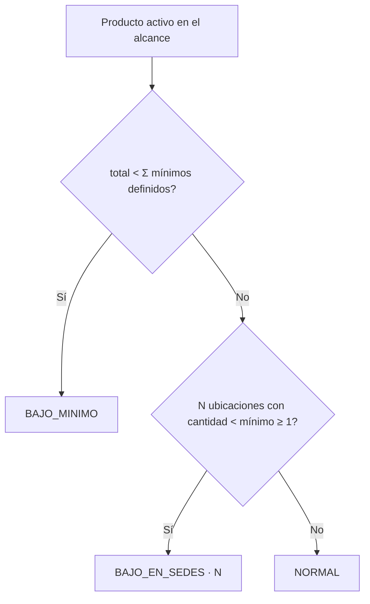
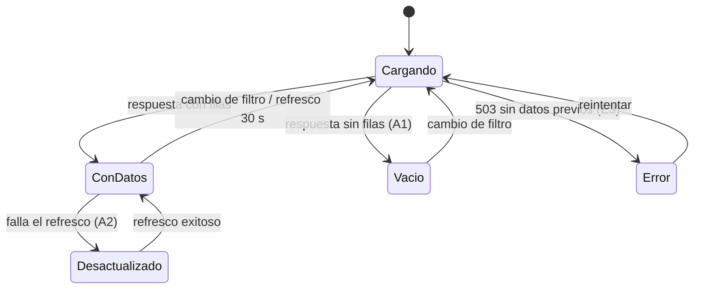

# SPEC-0004: Dashboard de stock consolidado

| Campo | Valor |
|---|---|
| ID | SPEC-0004 |
| Estado | En revisión (viva hasta el cierre de las HU) |
| Versión / fecha | 1.0 · 2026-11-22 |
| Épica · HU · CU | EP03 · HU-03.5 (stock por sede y consolidado); EP05 · HU-05.5 (alertas bajo el mínimo); EP06 · HU-06.2 (valoración por sede y consolidada); EP07 · HU-07.1 (reporte de stock por sede en PDF) · sin CU especificado |
| Prioridad · Talla | HU-03.5 Alta M 24 h · HU-05.5 Alta S 16 h · HU-06.2 Alta M 24 h · HU-07.1 Alta S 16 h (80 h en total) |
| Actores / roles | Administrador general (todas las ubicaciones) y jefe de sede (su sede por defecto y vista consolidada); comprador y contador como consumidores de alertas y valoración |
| ADR que la fundamentan | [ADR-0003](../02-adrs/0003-frontend-spa-react-typescript.md) · [ADR-0005](../02-adrs/0005-api-rest-json-https.md) · [ADR-0006](../02-adrs/0006-autenticacion-jwt-autorizacion-rbac-sede.md) · [ADR-0007](../02-adrs/0007-restriccion-acceso-ip-perimetro.md) · [ADR-0008](../02-adrs/0008-cache-consultas-redis.md) · [ADR-0014](../02-adrs/0014-reportes-pdf-predefinidos-servidor.md) |
| Mockup | [0004-dashboard-stock-consolidado.html](../04-mockups/0004-dashboard-stock-consolidado.html) |
| Problema que resuelve | 1 y 4: no hay vista consolidada ni en tiempo real del stock; no hay alertas de stock mínimo (apoya también el 6: valoración) |

## 1. Resumen / objetivo

Dar al administrador y a los jefes de sede una vista consolidada y casi en tiempo real del inventario de las 6 ubicaciones: indicadores clave, stock de cada producto por ubicación con su total y estado frente al mínimo, alertas de stock crítico, valor del inventario al costo promedio ponderado (CPP) por sede y consolidado, y exportación del reporte de stock por sede en PDF. Desde las alertas se navega a sugerir una orden de compra o a crear un traslado, sin que esta spec defina esos procesos.

## 2. Alcance

### Dentro

- Cuatro indicadores: referencias activas, valor del inventario (CPP) con variación frente al mes anterior, productos bajo el mínimo (y críticos) y traslados en tránsito (y con más de 48 h).
- Matriz producto × ubicación (Bodega central, Centro, Laureles, Poblado, Envigado, Bello) con total consolidado y estado, paginada.
- Filtros: sede (alcance), categoría, estado; búsqueda por código o nombre; orden.
- Resumen del conjunto filtrado («inventario visible»: unidades, productos, productos con alerta).
- Panel de stock crítico con acciones de navegación «Sugerir OC» y «Trasladar».
- Valor del inventario por ubicación y consolidado (HU-06.2).
- Detalle de un producto: stock, mínimo, máximo, CPP y valor por ubicación, y unidades en tránsito.
- Solicitud y descarga del reporte de stock por sede en PDF con los filtros activos (HU-07.1).
- Marca de tiempo de los datos y refresco periódico.

### Fuera

- Cálculo y aceptación de la sugerencia de reposición (HU-05.4) y creación de órdenes de compra (HU-05.2).
- Creación del traslado (HU-04.4, ver [SPEC-0002](0002-trasladar-mercancia-entre-sedes.md)).
- Definición de mínimos y máximos (HU-03.4) y cálculo del CPP (HU-06.1, ver [SPEC-0001](0001-registrar-entrada-mercancia.md)).
- Envío de alertas por correo (componente de notificaciones) y envío de la valoración a contabilidad (HU-08.1).
- Otros reportes en PDF (HU-07.2 a HU-07.6) y generación dinámica de reportes (fuera del alcance del proyecto).
- Aspectos visuales (layout, colores, gráficas, formato abreviado en millones): ver mockup.

## 3. Requisitos

### 3.1 Funcionales

| ID | Requisito | Origen |
|---|---|---|
| RF-0004-01 | El sistema debe bloquear el acceso al dashboard y a su API desde una IP pública no autorizada y registrar el intento en el log. | Necesidades §5 (acceso por IP); ADR-0007 |
| RF-0004-02 | El sistema debe exigir el permiso `inventario.consultar`; sin él, debe negar el acceso y registrar el intento en el log. | HU-01.2; ADR-0006 |
| RF-0004-03 | El sistema debe fijar el alcance por defecto según el rol: el administrador ve todas las ubicaciones activas; el jefe de sede ve su sede por defecto y puede cambiar a la vista consolidada o a otra ubicación (solo lectura). | HU-03.5; prototipo (usuarios: administrador y jefes de sede) |
| RF-0004-04 | El sistema debe calcular **referencias activas** = número de productos con estado activo en el catálogo, e informar cuántas ubicaciones activas cubre el alcance. | Prototipo (KPI 1) |
| RF-0004-05 | El sistema debe calcular el **valor del inventario** = Σ (cantidad × CPP) de cada producto en cada ubicación del alcance, con 2 decimales, y la **variación** = (valor actual − valor al cierre del mes anterior) / valor al cierre del mes anterior × 100. | HU-06.2; prototipo (KPI 2) |
| RF-0004-06 | El sistema debe calcular el **valor por ubicación** = Σ (cantidad × CPP) de la ubicación; el consolidado debe ser igual a la suma de las ubicaciones. El stock en tránsito se informa aparte (`valorEnTransito`) y no se suma a ninguna ubicación. | HU-06.2; prototipo (valor por sede) |
| RF-0004-07 | El sistema debe marcar una **celda bajo el mínimo** cuando `cantidad < mínimo(producto, ubicación)`; si el mínimo no está definido, la celda no se evalúa. | HU-05.5; HU-03.4 (mín/máx por producto y sede) |
| RF-0004-08 | El sistema debe asignar a cada producto un **estado** consolidado: `BAJO_MINIMO` si el total del alcance < Σ mínimos definidos del alcance; si no, `BAJO_EN_SEDES` (con el número N de ubicaciones bajo el mínimo) si N ≥ 1; si no, `NORMAL`. | HU-05.5; prototipo («Normal», «Bajo en N sedes», «Bajo mínimo»); regla propuesta (sección 8) |
| RF-0004-09 | El sistema debe calcular **productos bajo el mínimo** = productos activos con estado ≠ `NORMAL` en el alcance, y **críticos** = los que tienen al menos una ubicación con cantidad 0 y mínimo > 0. | Prototipo (KPI 3: «12 críticos (stock 0)») |
| RF-0004-10 | El sistema debe calcular **traslados en tránsito** = traslados en estado En tránsito con origen o destino en el alcance, y cuántos llevan más de 48 h desde el despacho (estrictamente > 48 h). | Prototipo (KPI 4); CU.0003 |
| RF-0004-11 | El sistema debe devolver la matriz producto × ubicación con una columna por ubicación activa, el total del alcance, el estado y las ubicaciones bajo el mínimo, paginada (25, 50 o 100 por página) y ordenable por código, nombre, total o estado. | HU-03.5; prototipo |
| RF-0004-12 | El filtro de **sede** debe cambiar el alcance de indicadores, panel crítico y valor; la matriz conserva todas las columnas e indica la ubicación seleccionada. Los filtros de **categoría**, **estado** y la **búsqueda** (código o nombre, mínimo 2 caracteres) aplican a la matriz, al resumen del conjunto filtrado y al PDF. | Prototipo (filtros) |
| RF-0004-13 | El sistema debe calcular el **resumen del conjunto filtrado**: unidades = Σ totales de las filas que cumplen los filtros, número de productos y número de productos con estado ≠ `NORMAL`. | Prototipo («Inventario visible») |
| RF-0004-14 | El sistema debe devolver el **panel de stock crítico** con los productos de estado ≠ `NORMAL` del alcance, ordenados por severidad (`BAJO_MINIMO` primero, luego `BAJO_EN_SEDES` por N descendente, luego por código), con un máximo de 10 y el total disponible. | HU-05.5; prototipo |
| RF-0004-15 | El sistema debe incluir en cada elemento del panel crítico las acciones que el usuario puede ejecutar: «Sugerir OC» (requiere `compras.crear`) y «Trasladar» (requiere `inventario.crear`). Al usarlas solo navega con el producto preseleccionado; el comportamiento posterior lo rigen HU-05.4 y SPEC-0002. | Prototipo (acciones directas) |
| RF-0004-16 | El sistema debe devolver el **detalle de un producto**: por ubicación, cantidad, mínimo, máximo, CPP, valor y marca de bajo mínimo o sobre máximo; además, unidades en tránsito entrantes y salientes. | HU-03.5 |
| RF-0004-17 | El sistema debe omitir los campos monetarios (valor, CPP, variación) para usuarios sin el permiso `valoracion.consultar`; el jefe de sede solo ve valores de su sede. | HU-06.2; ADR-0006; matriz pendiente (sección 8) |
| RF-0004-18 | El sistema debe permitir solicitar el **reporte de stock por sede en PDF** con los filtros activos; la generación es asíncrona en el servidor e incluye fecha y hora de corte, usuario, filtros, la matriz con totales y estados y, si el usuario tiene permiso, el valor por ubicación. La descarga es por URL firmada. | HU-07.1; ADR-0014 |
| RF-0004-19 | Cada respuesta debe incluir `generadoEn` (instante de corte de los datos). El cliente debe refrescar los indicadores y la página visible cada 30 s mientras la vista esté abierta. | Prototipo («actualizado hace 4 s»); regla propuesta |
| RF-0004-20 | El sistema debe invalidar los datos en caché del alcance afectado al recibir `stock.cambiado` (movimientos) o cambios de mínimo/máximo, de modo que la siguiente consulta refleje el cambio. | ADR-0008; SPEC-0001, SPEC-0002, SPEC-0003 (eventos) |
| RF-0004-21 | Si la consulta falla después de haber mostrado datos, el cliente debe conservar los últimos datos con su `generadoEn` e indicar que están desactualizados; si nunca hubo datos, debe indicar el error y permitir reintentar. | Prototipo (estados); decisión de diseño |

### 3.2 No funcionales

| ID | Categoría | Requisito medible |
|---|---|---|
| RNF-0004-01 | Rendimiento | Indicadores, panel crítico, valor por sede y una página de la matriz responden en < 2 s (p95) con 30 usuarios concurrentes y ~4.000 referencias × 6 ubicaciones. |
| RNF-0004-02 | Rendimiento | El detalle de un producto responde en < 2 s (p95). |
| RNF-0004-03 | Rendimiento | El PDF del catálogo completo (~4.000 referencias) queda `LISTO` en < 60 s (meta propuesta); la solicitud responde en < 2 s. |
| RNF-0004-04 | Frescura | Tras el commit de un movimiento, la siguiente consulta refleja el cambio en ≤ 5 s (invalidación de caché); con el refresco de 30 s, la vista abierta se actualiza en ≤ 35 s. |
| RNF-0004-05 | Consistencia | Indicadores, matriz y PDF de una misma respuesta se calculan sobre el mismo instante de corte (`generadoEn`); el consolidado siempre es igual a la suma de ubicaciones. |
| RNF-0004-06 | Seguridad | Toda llamada va por HTTPS con JWT; la autorización y el filtrado de campos monetarios se evalúan en servidor. |
| RNF-0004-07 | Seguridad | El control por IP se aplica antes de cualquier lógica; el 100 % de los accesos rechazados queda en el log. |
| RNF-0004-08 | Seguridad | La URL firmada del PDF expira a los 15 minutos y solo la puede solicitar el usuario que generó el reporte o un administrador. |
| RNF-0004-09 | Disponibilidad | Disponible de 6:00 a. m. a 10:00 p. m. (America/Bogota); si la caché no responde, se lee de la base de datos (degradado, sin error). |
| RNF-0004-10 | Auditoría | La generación y descarga de reportes y los accesos denegados quedan en el log; las consultas de lectura no se auditan una a una. |
| RNF-0004-11 | i18n / formato | Idioma es-CO; la API devuelve montos con 2 decimales en COP y porcentajes con 1 decimal; fechas ISO 8601, zona America/Bogota. |
| RNF-0004-12 | Accesibilidad | Los estados de producto no dependen solo del color (incluyen texto); la matriz es navegable por teclado y legible por lector de pantalla (objetivo WCAG 2.1 AA, a confirmar con el PO). |

## 4. Datos y contratos

### 4.1 Modelo de datos

Esta feature **lee** datos de otras; solo persiste los reportes solicitados.

| Fuente | Campos usados | Reglas |
|---|---|---|
| `producto` | id, código, nombre, categoría, unidad, estado | Solo activos en matriz e indicadores; los inactivos con stock suman al valor |
| `sede` | id, código, nombre, tipo (sede / bodega), estado | Solo ubicaciones activas como columnas |
| `stock_sede` (SPEC-0001) | producto_id, sede_id, cantidad, cpp | cantidad entero ≥ 0; cpp decimal(14,2) |
| `parametro_stock` (HU-03.4) | producto_id, sede_id, minimo, maximo | Enteros ≥ 0; pueden no estar definidos |
| `traslado` (SPEC-0002) | estado, sede origen, sede destino, fecha de despacho, líneas | Solo `EN_TRANSITO` para el indicador y el detalle |
| `valoracion_cierre_mes` (HU-06.2) | mes, sede_id, valor | Fotografía del valor al último día de cada mes; base de la variación |

**Reporte** (`reporte_generado`)

| Campo | Tipo | Oblig. | Reglas |
|---|---|---|---|
| id | UUID | Sí | PK |
| tipo | enum | Sí | `STOCK_POR_SEDE` (también `DIFERENCIAS_TOMA`, SPEC-0003) |
| parametros | JSON | Sí | filtros aplicados (sede, categoría, estado, búsqueda) |
| estado | enum | Sí | `EN_PROCESO`, `LISTO`, `FALLIDO` |
| solicitado_por, solicitado_en | UUID, timestamptz | Sí | |
| corte_en | timestamptz | Si listo | instante de los datos |
| archivo_key | texto | Si listo | objeto en almacenamiento (ADR-0014) |
| error | texto | Si fallido | causa técnica, no se muestra al usuario |

Ejemplo de verificación (datos del prototipo): Arroz Premium 1 kg = 820 + 64 + 51 + 72 + 40 + 58 = **1.105**; inventario visible de las 5 filas = 1.105 + 186 + 6 + 449 + 144 = **1.890** unidades, 5 productos, 3 con alerta; valor consolidado = 612 + 118 + 142 + 171 + 109 + 132 = **$1.284 M**. En «Aceite vegetal 3 L» la Bodega se toma como 143 (el prototipo muestra 140, que no cuadra con su total 186): 143 + 6 + 2 + 15 + 9 + 11 = 186.

### 4.2 API

Base `/api/v1`. JSON UTF-8. Fechas ISO 8601 (`2026-11-22T10:15:30-05:00`). Cabecera `Authorization: Bearer <JWT>`. Parámetro `sede` = código de ubicación o `TODAS`.

| Método y ruta | Permiso | Descripción |
|---|---|---|
| `GET /dashboard/stock/resumen?sede=` | `inventario.consultar` | Indicadores, valor por ubicación y panel crítico |
| `GET /stock?sede=&categoria=&estado=&q=&orden=&page=&size=` | `inventario.consultar` | Matriz producto × ubicación paginada y resumen del conjunto filtrado |
| `GET /stock/productos/{productoId}` | `inventario.consultar` | Detalle del producto por ubicación |
| `POST /reportes/stock-por-sede` | `inventario.consultar` | Solicita el PDF con los filtros |
| `GET /reportes/{id}` | `inventario.consultar` | Estado del reporte y URL firmada |

`GET /api/v1/dashboard/stock/resumen?sede=TODAS` → `200` (usuario administrador):

```json
{
  "generadoEn": "2026-11-22T10:15:30-05:00",
  "alcance": { "sede": "TODAS", "ubicaciones": 6 },
  "kpis": {
    "referenciasActivas": 3982,
    "valorInventario": 1284000000.00,
    "variacionMesAnteriorPct": 3.1,
    "productosBajoMinimo": 37,
    "productosCriticos": 12,
    "trasladosEnTransito": 8,
    "trasladosMas48h": 2
  },
  "valorPorUbicacion": [
    { "codigo": "BOD", "nombre": "Bodega central", "valor": 612000000.00 },
    { "codigo": "CEN", "nombre": "Centro", "valor": 118000000.00 },
    { "codigo": "LAU", "nombre": "Laureles", "valor": 142000000.00 },
    { "codigo": "POB", "nombre": "Poblado", "valor": 171000000.00 },
    { "codigo": "ENV", "nombre": "Envigado", "valor": 109000000.00 },
    { "codigo": "BEL", "nombre": "Bello", "valor": 132000000.00 }
  ],
  "valorEnTransito": 18450000.00,
  "stockCritico": {
    "total": 37,
    "items": [
      { "productoId": "P-01077", "nombre": "Detergente líquido 2 L", "estado": "BAJO_MINIMO",
        "ubicacionesBajoMinimo": ["BOD", "CEN", "ENV"], "total": 6, "acciones": ["SUGERIR_OC", "TRASLADAR"] },
      { "productoId": "P-00311", "nombre": "Aceite vegetal 3 L", "estado": "BAJO_EN_SEDES",
        "ubicacionesBajoMinimo": ["CEN", "LAU"], "total": 186, "acciones": ["SUGERIR_OC", "TRASLADAR"] },
      { "productoId": "P-02593", "nombre": "Papel higiénico x12", "estado": "BAJO_EN_SEDES",
        "ubicacionesBajoMinimo": ["ENV"], "total": 144, "acciones": ["SUGERIR_OC", "TRASLADAR"] }
    ]
  }
}
```

`GET /api/v1/stock?sede=TODAS&categoria=&estado=&q=&orden=codigo&page=1&size=25` → `200` (extracto con las 5 filas del prototipo):

```json
{
  "generadoEn": "2026-11-22T10:15:30-05:00",
  "ubicaciones": [
    { "codigo": "BOD", "nombre": "Bodega central" }, { "codigo": "CEN", "nombre": "Centro" },
    { "codigo": "LAU", "nombre": "Laureles" }, { "codigo": "POB", "nombre": "Poblado" },
    { "codigo": "ENV", "nombre": "Envigado" }, { "codigo": "BEL", "nombre": "Bello" }
  ],
  "items": [
    { "productoId": "P-00124", "nombre": "Arroz Premium 1 kg", "categoria": "Abarrotes",
      "stock": { "BOD": 820, "CEN": 64, "LAU": 51, "POB": 72, "ENV": 40, "BEL": 58 },
      "total": 1105, "estado": "NORMAL", "ubicacionesBajoMinimo": [] },
    { "productoId": "P-00311", "nombre": "Aceite vegetal 3 L", "categoria": "Abarrotes",
      "stock": { "BOD": 143, "CEN": 6, "LAU": 2, "POB": 15, "ENV": 9, "BEL": 11 },
      "total": 186, "estado": "BAJO_EN_SEDES", "ubicacionesBajoMinimo": ["CEN", "LAU"] },
    { "productoId": "P-01077", "nombre": "Detergente líquido 2 L", "categoria": "Aseo",
      "stock": { "BOD": 0, "CEN": 0, "LAU": 3, "POB": 1, "ENV": 0, "BEL": 2 },
      "total": 6, "estado": "BAJO_MINIMO", "ubicacionesBajoMinimo": ["BOD", "CEN", "ENV"] },
    { "productoId": "P-02210", "nombre": "Café molido 500 g", "categoria": "Abarrotes",
      "stock": { "BOD": 310, "CEN": 25, "LAU": 30, "POB": 44, "ENV": 21, "BEL": 19 },
      "total": 449, "estado": "NORMAL", "ubicacionesBajoMinimo": [] },
    { "productoId": "P-02593", "nombre": "Papel higiénico x12", "categoria": "Aseo",
      "stock": { "BOD": 95, "CEN": 12, "LAU": 8, "POB": 15, "ENV": 4, "BEL": 10 },
      "total": 144, "estado": "BAJO_EN_SEDES", "ubicacionesBajoMinimo": ["ENV"] }
  ],
  "resumen": { "unidades": 1890, "productos": 5, "conAlerta": 3 },
  "page": 1, "size": 25, "total": 5
}
```

`GET /api/v1/stock/productos/P-00311` → `200`:

```json
{
  "productoId": "P-00311", "nombre": "Aceite vegetal 3 L", "unidad": "Und",
  "generadoEn": "2026-11-22T10:15:30-05:00",
  "ubicaciones": [
    { "codigo": "LAU", "cantidad": 2, "minimo": 10, "maximo": 60, "cpp": 27831.00,
      "valor": 55662.00, "bajoMinimo": true, "sobreMaximo": false }
  ],
  "enTransito": { "entrante": 0, "saliente": 0 },
  "total": 186
}
```

`POST /api/v1/reportes/stock-por-sede`

```json
{ "sede": "TODAS", "categoria": null, "estado": "BAJO_EN_SEDES", "q": null }
```

Respuesta `202`: `{ "reporteId": "r-41c...", "estado": "EN_PROCESO" }`. `GET /api/v1/reportes/r-41c...` → `200` `{ "estado": "LISTO", "url": "https://…firmada…", "expiraEn": "2026-11-22T10:31:00-05:00", "corteEn": "2026-11-22T10:15:31-05:00" }`.

Para un usuario sin `valoracion.consultar`, `valorInventario`, `variacionMesAnteriorPct`, `valorPorUbicacion`, `valorEnTransito`, `cpp` y `valor` se omiten de las respuestas.

Formato de error: el mismo de SPEC-0001 (`error.codigo`, `error.mensaje`, `error.detalles[]`, `error.traceId`).

### 4.3 Eventos consumidos y emitidos

| Evento | Dirección | Cuándo | Efecto |
|---|---|---|---|
| `stock.cambiado` | Consumido | Tras entradas, traslados, ajustes de toma, ventas (SPEC-0001/0002/0003, HU-08.2) | Invalida la caché de las ubicaciones y productos afectados |
| `parametros_stock.cambiados` | Consumido | Cambio de mínimo o máximo (HU-03.4) | Invalida estados y alertas del producto |
| `reporte.solicitado` | Emitido | Solicitud del PDF | Encola la generación en el worker (ADR-0014) |
| `auditoria.registrada` | Emitido | Generación y descarga de reportes; accesos denegados | Registro append-only |

### 4.4 Errores

| HTTP | Código | Cuándo | Mensaje al usuario |
|---|---|---|---|
| 401 | NO_AUTENTICADO | JWT ausente o vencido | «Su sesión expiró. Inicie sesión de nuevo.» |
| 403 | IP_NO_AUTORIZADA | IP fuera de las sedes habilitadas | «Acceso no permitido desde esta ubicación.» |
| 403 | SIN_PERMISO | Rol sin `inventario.consultar`; descarga de un reporte ajeno | «No tiene permiso para esta acción.» |
| 404 | PRODUCTO_NO_ENCONTRADO | Producto inexistente en el detalle | «Producto no encontrado.» |
| 404 | REPORTE_NO_ENCONTRADO | Id de reporte inexistente | «El reporte no existe.» |
| 409 | SEDE_INACTIVA | Filtro con una ubicación inactiva | «La sede está inactiva.» |
| 422 | VALIDACION | Filtro inválido (sede o categoría inexistentes, estado fuera de la lista, búsqueda de menos de 2 caracteres, `size` fuera de 25/50/100) | Motivo por campo |
| 503 | DATOS_NO_DISPONIBLES | Ni la caché ni la base de datos responden | «No pudimos actualizar el stock. Intente de nuevo.» |

## 5. Flujos y estados

**Flujo principal**

1. El usuario abre Dashboard.
2. El sistema verifica IP y permiso `inventario.consultar`.
3. El sistema fija el alcance por rol (administrador: todas; jefe de sede: su sede).
4. El sistema devuelve indicadores, valor por ubicación, panel crítico y la primera página de la matriz, con `generadoEn`.
5. El usuario cambia la sede, la categoría, el estado o busca; el sistema recalcula lo que corresponde a cada filtro (RF-0004-12).
6. El usuario abre el detalle de un producto.
7. El usuario solicita el PDF; el sistema lo genera de forma asíncrona y entrega la URL de descarga.
8. Desde el panel crítico, el usuario navega a «Sugerir OC» o «Trasladar».
9. Cada 30 s el cliente refresca indicadores y página visible.

**Alternativos**

| ID | Situación | Comportamiento |
|---|---|---|
| A1 | Los filtros no devuelven productos | Matriz vacía, resumen en 0; los indicadores no cambian (dependen solo de la sede) |
| A2 | Falla un refresco después de haber mostrado datos | Se conservan los últimos datos con su `generadoEn` y se marcan como desactualizados |
| A3 | Caché no disponible | Lectura directa de la base de datos, sin error para el usuario |
| A4 | El usuario no tiene permiso de valoración | Se omiten los campos monetarios |
| A5 | El usuario no tiene permiso para una acción del panel crítico | La acción no se incluye en `acciones` |

**Error**

| ID | Situación | Comportamiento |
|---|---|---|
| E1 | IP no autorizada | 403 `IP_NO_AUTORIZADA`; intento en log |
| E2 | Sin permiso de consulta | 403 `SIN_PERMISO`; intento en log |
| E3 | Base de datos y caché no disponibles sin datos previos | 503 `DATOS_NO_DISPONIBLES`; el cliente permite reintentar |
| E4 | Falla la generación del PDF | El reporte queda `FALLIDO`; el usuario puede solicitarlo de nuevo |

Regla de estado del producto:



Estados de la consulta (comportamiento, no apariencia):



Estados del reporte: `EN_PROCESO` → `LISTO` (URL firmada renovable mientras exista el archivo) | `FALLIDO`.

## 6. Casos borde

| ID | Caso | Comportamiento esperado |
|---|---|---|
| CB-0004-01 | Producto sin mínimo definido en ninguna ubicación | No se evalúa; estado `NORMAL` con `sinMinimo: true`; no cuenta en alertas |
| CB-0004-02 | Cantidad 0 con mínimo 0 o sin mínimo | No es crítico |
| CB-0004-03 | Producto inactivo con stock | No aparece en matriz ni en indicadores de referencias, pero su valor suma al valor del inventario |
| CB-0004-04 | Ubicación inactiva con stock | No es columna ni filtro; su valor se informa aparte en `ubicacionesInactivas` para no perderlo del consolidado contable |
| CB-0004-05 | Stock en tránsito | No suma a ninguna ubicación; se informa en `valorEnTransito` y en el detalle (`enTransito`) |
| CB-0004-06 | Producto con CPP 0 | Valor 0; las cantidades se muestran normalmente |
| CB-0004-07 | Filtros sin resultados (A1) | `items` vacío, resumen en 0 |
| CB-0004-08 | Búsqueda de 1 carácter | `VALIDACION` |
| CB-0004-09 | `size` distinto de 25, 50 o 100 | `VALIDACION` |
| CB-0004-10 | Movimiento confirmado mientras la vista está abierta | Aparece en el siguiente refresco (≤ 35 s) |
| CB-0004-11 | Caché caída (A3) | Lectura desde la base de datos; puede exceder 2 s sin error |
| CB-0004-12 | Base de datos caída después de mostrar datos (A2) | Se conservan los datos anteriores marcados como desactualizados |
| CB-0004-13 | Jefe de sede consulta la vista consolidada | Ve unidades de todas las ubicaciones; valores solo de su sede (A4) |
| CB-0004-14 | Usuario sin `compras.crear` o `inventario.crear` | No recibe la acción correspondiente en el panel crítico |
| CB-0004-15 | Primer mes de operación sin cierre anterior | `variacionMesAnteriorPct` nulo |
| CB-0004-16 | Traslado con exactamente 48 h en tránsito | No cuenta como «más de 48 h» (> 48 h estricto) |
| CB-0004-17 | Cambio de mínimo de un producto | Su estado y las alertas se recalculan en la siguiente consulta |
| CB-0004-18 | Movimientos durante la generación del PDF | El PDF refleja el instante de corte `corteEn`; no mezcla datos de antes y después |
| CB-0004-19 | Generación del PDF fallida (E4) | `FALLIDO`; se puede volver a solicitar |
| CB-0004-20 | URL firmada vencida | `GET /reportes/{id}` entrega una URL nueva si el archivo existe |
| CB-0004-21 | PDF con las ~4.000 referencias | Se genera completo de forma asíncrona (RNF-0004-03) |
| CB-0004-22 | Sede seleccionada inexistente o inactiva | `VALIDACION` o `SEDE_INACTIVA` |
| CB-0004-23 | Redondeo de valores | Se calcula con el CPP de 2 decimales; el consolidado es la suma exacta de las ubicaciones (sin redondeos intermedios) |
| CB-0004-24 | Total consolidado ≥ Σ mínimos pero una sede en 0 | Estado `BAJO_EN_SEDES` (se resuelve con traslado) y cuenta como crítico |

## 7. Criterios de aceptación

**CA derivados de HU-03.5, HU-05.5, HU-06.2, HU-07.1 y del prototipo**: la fuente no trae criterios Dado/Cuando/Entonces para estas historias.

| ID | Criterio |
|---|---|
| CA-0004-01 (HU-03.5 · Stock por sede y consolidado) | **Dado que** soy administrador y abro el dashboard sin filtros, **cuando** veo Arroz Premium 1 kg, **entonces** veo su stock en cada una de las 6 ubicaciones (820, 64, 51, 72, 40, 58) y un total consolidado de 1.105. |
| CA-0004-02 (HU-03.5 · Alcance del jefe de sede) | **Dado que** soy jefe de sede de Laureles, **cuando** abro el dashboard, **entonces** el alcance por defecto es Laureles y puedo cambiar a la vista consolidada. |
| CA-0004-03 (HU-05.5 · Bajo en sedes) | **Dado que** Papel higiénico x12 tiene 4 unidades en Envigado con mínimo 6 y su total cubre la suma de mínimos, **cuando** consulto la matriz, **entonces** su estado es «Bajo en 1 sede», Envigado aparece bajo el mínimo y el producto figura en el panel crítico. |
| CA-0004-04 (HU-05.5 · Bajo mínimo) | **Dado que** Detergente líquido 2 L tiene un total de 6 y la suma de sus mínimos es mayor, **cuando** consulto la matriz, **entonces** su estado es «Bajo mínimo», es crítico (tiene ubicaciones en 0) y encabeza el panel crítico. |
| CA-0004-05 (HU-05.5 · Indicadores de alerta) | **Dado que** 37 productos tienen estado distinto de Normal y 12 de ellos tienen alguna ubicación en 0 con mínimo > 0, **cuando** abro el dashboard, **entonces** el indicador muestra 37 bajo el mínimo y 12 críticos. |
| CA-0004-06 (HU-06.2 · Valoración) | **Dado que** el valor al CPP por ubicación es Bodega 612 M, Centro 118 M, Laureles 142 M, Poblado 171 M, Envigado 109 M y Bello 132 M, **cuando** abro el dashboard como administrador, **entonces** el valor del inventario es $1.284 M y es igual a la suma de las ubicaciones. |
| CA-0004-07 (HU-06.2 · Permiso de valoración) | **Dado que** mi rol no tiene `valoracion.consultar`, **cuando** consulto el dashboard, **entonces** las respuestas no incluyen valores ni CPP. |
| CA-0004-08 (HU-07.1 · PDF) | **Dado que** filtré por estado «Bajo en sedes», **cuando** solicito el PDF, **entonces** recibo `202` y, al quedar `LISTO`, una URL firmada de un PDF con la fecha de corte, el usuario, los filtros y solo los productos filtrados con su stock por ubicación, total y estado. |
| CA-0004-09 (Inventario visible) | **Dado que** la matriz filtrada contiene las 5 filas del prototipo, **cuando** consulto el resumen, **entonces** muestra 1.890 unidades, 5 productos y 3 con alerta. |
| CA-0004-10 (Filtro sin resultados) | **Dado que** busco «zzz», **cuando** se aplica el filtro, **entonces** la matriz está vacía, el resumen está en 0 y los indicadores no cambian. |
| CA-0004-11 (Traslados en tránsito) | **Dado que** hay 8 traslados en tránsito y 2 fueron despachados hace más de 48 h, **cuando** abro el dashboard, **entonces** el indicador muestra 8 y «2 con más de 48 h». |
| CA-0004-12 (Frescura) | **Dado que** el dashboard está abierto, **cuando** se confirma una entrada de 24 unidades de Aceite vegetal 3 L en Laureles, **entonces** en el siguiente refresco (≤ 35 s) Laureles muestra 26 y el total 210. |
| CA-0004-13 (Rendimiento) | **Dado que** hay 30 usuarios concurrentes y ~4.000 referencias, **cuando** consultan indicadores, matriz o detalle, **entonces** el p95 de la respuesta es < 2 s. |
| CA-0004-14 (Intento denegado) | **Dado que** accedo desde una IP no autorizada o sin `inventario.consultar`, **cuando** abro el dashboard, **entonces** el sistema responde 403 y registra el intento en el log. |
| CA-0004-15 (Datos desactualizados) | **Dado que** el dashboard ya mostró datos, **cuando** un refresco responde 503, **entonces** se conservan los datos anteriores con su `generadoEn` y se indican como desactualizados. |
| CA-0004-16 (Acciones según permisos) | **Dado que** soy contador sin `compras.crear` ni `inventario.crear`, **cuando** veo el panel crítico, **entonces** no recibo las acciones «Sugerir OC» ni «Trasladar». |
| CA-0004-17 (Detalle de producto) | **Dado que** abro el detalle de Aceite vegetal 3 L, **cuando** se carga, **entonces** veo por ubicación la cantidad, el mínimo, el máximo, el CPP y el valor, con Laureles marcado bajo el mínimo. |
| CA-0004-18 (Búsqueda) | **Dado que** escribo «P-003» o «aceite», **cuando** se aplica la búsqueda, **entonces** la matriz muestra Aceite vegetal 3 L. |

**Definición de terminado (derivada; la fuente no la define para estas HU):** consultas < 2 s verificadas en prueba de carga (HU-09.3), reglas de estado y valoración validadas con los datos del prototipo, PDF generado y descargable, permisos de valoración verificados y criterios probados por QA.

## 8. Riesgos y pendientes

| Tipo | Descripción | Responsable | Estado |
|---|---|---|---|
| Decisión abierta | Regla de estado propuesta: `BAJO_MINIMO` si el total < Σ mínimos (requiere compra); `BAJO_EN_SEDES` si alguna ubicación está bajo su mínimo pero el total alcanza (se resuelve con traslado). El prototipo muestra las etiquetas pero no la regla. | PO / comprador | Pendiente |
| Decisión abierta | Definición de «crítico»: alguna ubicación en 0 con mínimo > 0 (adoptada) frente a total consolidado en 0. | PO | Pendiente |
| Decisión abierta | Frecuencia de refresco (30 s propuesto) y frescura máxima aceptable. | PO | Pendiente |
| Decisión abierta | Si el valor en tránsito se suma al valor consolidado o se informa aparte (adoptado: aparte). | Contador | Pendiente |
| Decisión abierta | Matriz de visibilidad de valores por rol (`valoracion.consultar`: administrador y contador en todas las sedes; jefe de sede solo la suya; comprador sin valores) dentro de HU-01.2. | PO | Pendiente |
| Decisión abierta | Orden del panel crítico: por severidad (adoptado); el prototipo muestra los productos por código. | PO | Pendiente |
| Decisión abierta | Tratamiento de productos sin mínimo definido (hoy: `NORMAL` con `sinMinimo`). | Comprador | Pendiente |
| Dependencia | La variación frente al mes anterior requiere la fotografía mensual de valoración (HU-06.2). | Equipo de desarrollo / contador | Abierto |
| Dependencia | Mínimos y máximos por producto y sede (HU-03.4) y catálogo cargado (HU-03.6); sin ellos no hay alertas. | Comprador / administrador | Abierto |
| Dependencia | Destinos de navegación: sugerencia de reposición (HU-05.4) y nuevo traslado (SPEC-0002). | Equipo de desarrollo | Abierto |
| Dependencia | Alertas por correo de stock mínimo (componente de notificaciones) se especificarán aparte. | PO | Abierto |
| Riesgo | Rendimiento de la matriz 4.000 × 6 con filtros y estados calculados; mitigar con caché (ADR-0008), paginación y cálculo precomputado por producto. | Equipo de desarrollo | Abierto |
| Riesgo | Datos desfasados por fallas de invalidación de caché; mitigar con expiración máxima de 60 s además de la invalidación por eventos. | Equipo de desarrollo | Abierto |
