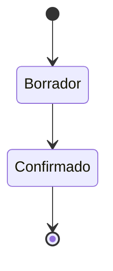

# SPEC-NNNN: <Nombre de la feature>

> Plantilla del artefacto **Specs** (capa de detalle). Una spec describe **qué** debe hacer una funcionalidad y **cómo**, con el detalle suficiente para implementarla y verificarla: requisitos, comportamiento, contratos, casos borde y criterios de aceptación. Es detallada, precisa y verificable; viva mientras se diseña y se construye, y **se acuerda antes de codificar**.
>
> Archivo: `03-specs/NNNN-feature.md` (una por feature). Su mockup lleva el mismo número: `04-mockups/NNNN-feature.html`.

| Campo | Valor |
|---|---|
| ID | SPEC-NNNN |
| Estado | Borrador · En revisión (viva hasta el cierre de la HU) · Acordada · Cerrada |
| Versión / fecha | 1.0 · AAAA-MM-DD |
| Épica · HU · CU | EPxx … · HU-xx.x … · CU.xxxx |
| Prioridad · Talla | … · … (horas) |
| Actores / roles | … |
| ADR que la fundamentan | [ADR-NNNN](../02-adrs/NNNN-titulo.md) · … |
| Mockup | [NNNN-feature.html](../04-mockups/NNNN-feature.html) |
| Problema que resuelve | n.º y texto corto |

## 1. Resumen / objetivo

_Qué resuelve la funcionalidad y para quién, en un párrafo. Incluye el resultado observable al terminar (qué cambia en el sistema)._

## 2. Alcance

### Dentro

- _Lo que esta spec cubre (comportamientos, operaciones, consultas)._

### Fuera

- _Lo que explícitamente queda fuera y en qué HU/spec vive. Termina siempre con: «Aspectos visuales (layout, colores, tamaños): ver mockup»._

## 3. Requisitos

### 3.1 Funcionales

_Comportamiento esperado. Una fila por requisito, redactado «El sistema debe…», verificable y con su origen (paso o restricción del CU, HU, CA, decisión de diseño)._

| ID | Requisito | Origen |
|---|---|---|
| RF-NNNN-01 | El sistema debe … | CU.xxxx paso n / HU-xx.x CAn |

### 3.2 No funcionales

_Rendimiento, seguridad, auditoría, integridad, disponibilidad, i18n/formato (es-CO, COP, ISO 8601), accesibilidad (a11y). Siempre medibles._

| ID | Categoría | Requisito medible |
|---|---|---|
| RNF-NNNN-01 | Rendimiento | … < n s (p95) con 30 usuarios concurrentes |

## 4. Datos y contratos

### 4.1 Modelo de datos

_Entidades de la feature: campo, tipo, obligatoriedad y reglas (rangos, unicidad, inmutabilidad, estados). Incluye fórmulas de cálculo y un ejemplo numérico verificable._

| Campo | Tipo | Oblig. | Reglas |
|---|---|---|---|
| … | … | … | … |

### 4.2 API

_Endpoints REST bajo `/api/v1`: método, ruta, permiso requerido, request y response JSON de ejemplo y cabeceras (JWT, `Idempotency-Key` en operaciones que cambian stock). Usa el formato de error común._

| Método y ruta | Permiso | Descripción |
|---|---|---|
| `POST /recurso` | `modulo.accion` | … |

```json
{ "ejemplo": "request" }
```

### 4.3 Eventos emitidos

_Eventos hacia kardex, auditoría, cola de integraciones, notificaciones o caché: cuándo se emiten (misma transacción o tras commit) y su contenido clave._

| Evento | Destino | Cuándo | Contenido clave |
|---|---|---|---|
| … | … | … | … |

### 4.4 Errores

_Un código por situación de error, con HTTP, condición y mensaje al usuario. Reutiliza los códigos comunes (`NO_AUTENTICADO`, `IP_NO_AUTORIZADA`, `SIN_PERMISO`, `SEDE_NO_ASIGNADA`, `VALIDACION`, `CONFLICTO_VERSION`, …)._

| HTTP | Código | Cuándo | Mensaje al usuario |
|---|---|---|---|
| … | … | … | … |

## 5. Flujos y estados

_Caminos, transiciones y errores._

**Flujo principal**

1. _Paso numerado (normalizado desde la secuencia normal del CU)._

**Alternativos**

| ID | Situación | Comportamiento |
|---|---|---|
| A1 | … | … |

**Error**

| ID | Situación | Comportamiento |
|---|---|---|
| E1 | … | … |

_Diagrama de estados cuando la entidad tenga estados:_



## 6. Casos borde

_No solo el camino feliz: los A/E del CU más concurrencia, idempotencia (doble clic), entidades inactivas, redondeos, fallas parciales de transacción, sistemas externos caídos, sesión vencida, límites de rango._

| ID | Caso | Comportamiento esperado |
|---|---|---|
| CB-NNNN-01 | … | … |

## 7. Criterios de aceptación

_Cómo se verifica. Formato Dado / Cuando / Entonces. Copia fielmente los CA de la HU fuente y agrega los de casos borde y no funcionales. Sin criterios de aceptación, la spec no está lista._

| ID | Criterio |
|---|---|
| CA-NNNN-01 (HU CA1 · …) | **Dado que** …, **cuando** …, **entonces** … |

**Definición de terminado (HU-xx.x):** _copiar de la HU y agregar lo propio de la spec._

## 8. Riesgos y pendientes

_Dependencias y decisiones abiertas, con responsable y estado._

| Tipo | Descripción | Responsable | Estado |
|---|---|---|---|
| Dependencia / Decisión abierta / Riesgo | … | … | Abierto / Pendiente / Resuelto |

---

## Checklist antes de codificar

- [ ] Tiene criterios de aceptación explícitos y verificables (sección 7).
- [ ] Cubre casos borde y errores, no solo el camino feliz (secciones 5 y 6).
- [ ] Referencia los ADR que la fundamentan (tabla de metadatos).
- [ ] No contiene decisiones visuales (layout, colores, tamaños): van al mockup con el mismo número.
- [ ] No contiene decisiones de arquitectura (stack, BD, estilo de API, despliegue): van a un ADR.
- [ ] Los requisitos no funcionales son medibles.
- [ ] Los pendientes de la sección 8 no bloquean la implementación o tienen un valor por defecto.
- [ ] Acordada con el Product Owner.
