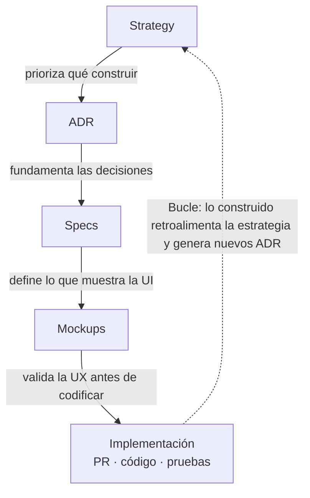

# Documentación — StockCentral

## 1. Propósito

Esta documentación organiza el proyecto de lo general a lo detallado: primero el rumbo de negocio, luego las decisiones de arquitectura, después las especificaciones por funcionalidad y finalmente los mockups navegables.

Fuente: Entrega N.°4 — «Sistema Centralizado de Gestión de Inventarios y Control de Stock en Tiempo Real», Grupo 1, Ingeniería de Requisitos, ITM, 2026.

## 2. Estructura

```
docs/
├── README.md
├── 01-strategy/   strategy.md · vision.md · template.md
├── 02-adrs/       (consecutivos, globales) 0001-…0015-… · template.md
├── 03-specs/      (una por feature) 0001-…0004-… · template.md
└── 04-mockups/    (HTML navegable · mismo n.° que su spec) 0001-…0004-….html · template.md
```

## 3. Los 4 artefactos

| Artefacto | Capa | Pregunta que responde | Horizonte | Cambia cuando… |
|---|---|---|---|---|
| Strategy | Negocio | ¿Por qué ganamos y defendemos? | Años | Cambia la estrategia o el mercado |
| ADR | Arquitectura | ¿Por qué decidimos así? | Permanente (inmutable) | Otra decisión lo supersede |
| Specs | Detalle | ¿Qué y cómo, al detalle? | Por funcionalidad | Cambia el alcance o el comportamiento |
| Mockups | Visual/UI | ¿Cómo se ve y se navega? | Por pantalla | Cambia el diseño o la UX |

## 4. Relación entre artefactos



**Strategy fija el rumbo, el ADR decide, la Spec detalla y el Mockup lo hace visible — y construir retroalimenta la estrategia.**

## 5. Convenciones

- Carpetas numeradas 01 → 04, de lo general a lo detallado.
- `02-adrs/NNNN-titulo.md`: consecutivo global e inmutable; nunca se borra, se «supersede». Estados: Propuesto / Aceptado / Superado / Obsoleto.
- `03-specs/NNNN-feature.md`: una por funcionalidad, con criterios de aceptación.
- `04-mockups/NNNN-feature.html`: autocontenido y navegable; mismo número que su spec.
- Un `template.md` por carpeta.
- Cada PR enlaza su `.md` correspondiente.

## 6. Índice de archivos

### 01-strategy
- [strategy.md](01-strategy/strategy.md): estrategia y defensibilidad del producto.
- [vision.md](01-strategy/vision.md): visión, misión y principios.
- [template.md](01-strategy/template.md): plantilla de Strategy.

### 02-adrs
- [template.md](02-adrs/template.md): plantilla de ADR.
- [0001-arquitectura-monolito-modular.md](02-adrs/0001-arquitectura-monolito-modular.md): monolito modular.
- [0002-backend-java-spring-boot.md](02-adrs/0002-backend-java-spring-boot.md): backend Java con Spring Boot.
- [0003-frontend-spa-react-typescript.md](02-adrs/0003-frontend-spa-react-typescript.md): frontend SPA con React y TypeScript.
- [0004-base-datos-postgresql.md](02-adrs/0004-base-datos-postgresql.md): base de datos PostgreSQL.
- [0005-api-rest-json-https.md](02-adrs/0005-api-rest-json-https.md): API REST con JSON sobre HTTPS.
- [0006-autenticacion-jwt-autorizacion-rbac-sede.md](02-adrs/0006-autenticacion-jwt-autorizacion-rbac-sede.md): autenticación JWT y autorización RBAC por sede.
- [0007-restriccion-acceso-ip-perimetro.md](02-adrs/0007-restriccion-acceso-ip-perimetro.md): restricción de acceso por IP.
- [0008-cache-consultas-redis.md](02-adrs/0008-cache-consultas-redis.md): caché de consultas con Redis.
- [0009-integraciones-asincronas-cola-mensajes.md](02-adrs/0009-integraciones-asincronas-cola-mensajes.md): integraciones asíncronas con cola de mensajes.
- [0010-despliegue-aws-ecs-fargate.md](02-adrs/0010-despliegue-aws-ecs-fargate.md): despliegue en AWS ECS Fargate.
- [0011-infraestructura-como-codigo-ci-cd.md](02-adrs/0011-infraestructura-como-codigo-ci-cd.md): infraestructura como código y CI/CD.
- [0012-kardex-inmutable-movimiento-inverso.md](02-adrs/0012-kardex-inmutable-movimiento-inverso.md): kardex inmutable con movimiento inverso.
- [0013-log-auditoria-append-only.md](02-adrs/0013-log-auditoria-append-only.md): log de auditoría append-only.
- [0014-reportes-pdf-predefinidos-servidor.md](02-adrs/0014-reportes-pdf-predefinidos-servidor.md): reportes PDF predefinidos en servidor.
- [0015-respaldos-diarios-aws-backup.md](02-adrs/0015-respaldos-diarios-aws-backup.md): respaldos diarios con AWS Backup.

### 03-specs
- [template.md](03-specs/template.md): plantilla de Spec.
- [0001-registrar-entrada-mercancia.md](03-specs/0001-registrar-entrada-mercancia.md): registrar entrada de mercancía (CU.0002 · HU-04.1).
- [0002-trasladar-mercancia-entre-sedes.md](03-specs/0002-trasladar-mercancia-entre-sedes.md): trasladar mercancía entre sedes (CU.0003 · HU-04.4, HU-04.5).
- [0003-toma-fisica-conciliacion.md](03-specs/0003-toma-fisica-conciliacion.md): toma física y conciliación (CU.0004 · HU-04.6).
- [0004-dashboard-stock-consolidado.md](03-specs/0004-dashboard-stock-consolidado.md): dashboard de stock consolidado (HU-03.5, HU-05.5, HU-06.2, HU-07.1).

### 04-mockups
- [template.md](04-mockups/template.md): plantilla de mockup.
- [0001-registrar-entrada-mercancia.html](04-mockups/0001-registrar-entrada-mercancia.html): mockup de la Spec 0001.
- [0002-trasladar-mercancia-entre-sedes.html](04-mockups/0002-trasladar-mercancia-entre-sedes.html): mockup de la Spec 0002.
- [0003-toma-fisica-conciliacion.html](04-mockups/0003-toma-fisica-conciliacion.html): mockup de la Spec 0003.
- [0004-dashboard-stock-consolidado.html](04-mockups/0004-dashboard-stock-consolidado.html): mockup de la Spec 0004.

## 7. Matriz de trazabilidad

| Problema | Épica | HU | CU | Spec | Mockup | ADRs principales |
|---|---|---|---|---|---|---|
| 1. Sin vista consolidada | EP03 / EP07 | HU-03.5, HU-07.1 | — | 0004 | 0004 | 0008, 0014 |
| 2. Traslados sin trazabilidad | EP04 | HU-04.4, HU-04.5 | CU.0003 | 0002 | 0002 | 0012, 0013 |
| 3. Sin control de quién modifica | EP01 / EP04 | HU-01.2, HU-01.5, HU-04.1 | CU.0002 | 0001 | 0001 | 0006, 0012, 0013 |
| 4. Sin alertas de mínimo | EP05 | HU-05.5 | — | 0004 | 0004 | — |
| 5. Conteos sin conciliación | EP04 | HU-04.6 | CU.0004 | 0003 | 0003 | 0012, 0014 |
| 6. Valoración manual y tardía | EP06 / EP08 | HU-06.1, HU-06.2, HU-08.1 | CU.0002 | 0001, 0004 | — | 0009 |
| 7. Abrir sede nueva | EP02 / EP03 | HU-02.1, HU-02.2 | — | (sin spec aún) | — | 0007 |
| 8. Sin respaldo | EP09 | HU-09.2 | — | (sin spec aún) | — | 0010, 0015 |

> Las HU sin spec quedan para iteraciones siguientes.

---

## Créditos

Esta documentación fue creada con **Claude** (Claude Code), usando el modelo **Claude Opus 5.5** con esfuerzo **Extra** y con **gestión de agentes**: una sesión orquestadora repartió el trabajo entre subagentes que trabajaron en paralelo (Strategy, ADRs, Specs y Mockups) y luego revisó cada artefacto contra la definición de Strategy, ADR, Specs y Mockups.
